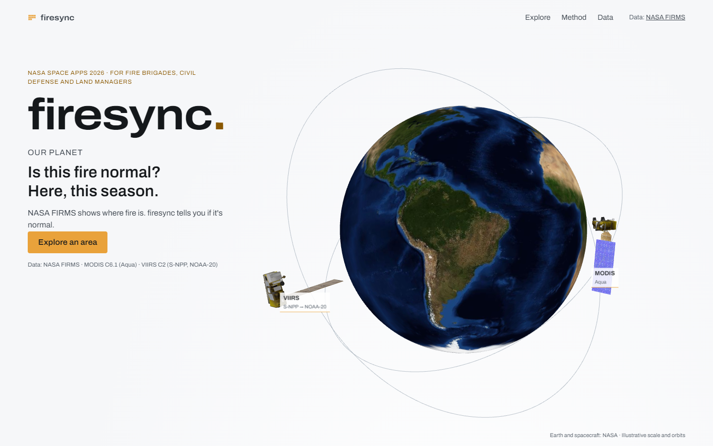
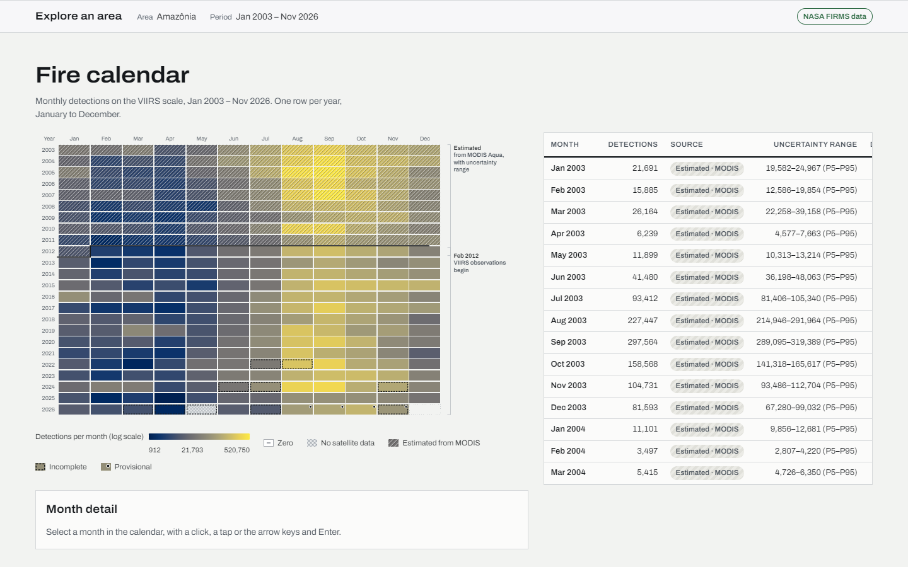

# firesync

**The Amazon is burning. Where should firefighters act first?**

firesync turns NASA satellite fire data into answers for fire crews: which areas are critical today, whether today's fire is normal for this place and season, and where fire risk is very high for the next 14 days.

## 🔥 Try it: **[firesync.nogranlabs.com.br](https://firesync.nogranlabs.com.br)**

Free, no login, desktop and mobile.

- **Live app:** https://firesync.nogranlabs.com.br
- **Public API:** https://firesync-api.nogranlabs.com.br/docs
- **Project page text, with the full method, results and references:** [docs/pagina-projeto.md](docs/pagina-projeto.md)
- **Challenge:** [MODIS and VIIRS Hot Spots](https://www.spaceappschallenge.org/2026/challenges/modis-and-viirs-hot-spots/) · NASA Space Apps Challenge 2026
- **Team page:** [27 Threads · Uberlândia, Brazil](https://www.spaceappschallenge.org/2026/find-a-team/27-threads-uberlandia/)



## For judges: what firesync does

Fire teams in Brazil can see where satellites detect fire today, but not whether that is normal for the place and the season. Answering needs a long record, and NASA's record comes from two sensors that do not agree: VIIRS records about six times more detections than MODIS over the same fires. firesync converts the MODIS Aqua record (2003 to early 2012) to the VIIRS scale with factors calibrated in the 13 years both sensors flew, and joins it with VIIRS into **one monthly series from January 2003, with the uncertainty shown** wherever a month is estimated.



- **Fire calendar** (months × years) for any area drawn in Brazil, with the seasonal pattern and the highest-fire years.
- **Where to look first:** areas ranked by alert level (Normal, Attention, Critical), comparing the last 7 days with the same dates in earlier years, and by a **14-day fire risk** from a model trained only on past data.
- **Recent detections map** for the last 24 hours, 72 hours or 7 days.
- **Ask firesync:** a chat assistant that answers in the language of the question, using the same API functions as the screen, with every number checked.
- **Audit package:** a ZIP with raw counts, factors and formula, so anyone can rebuild every number.

## What we measured

All numbers below were measured, with pass criteria fixed before each run. Details in [docs/pagina-projeto.md](docs/pagina-projeto.md).

| Check | Result |
| --- | --- |
| Calibration, leave-one-year-out (Amazon) | 5.7% average yearly error in 2012–2021, 6.4% in 2022–2024 |
| Independent check against INPE, Brazil's space agency (2003–2025) | monthly correlation 0.94 to 0.99 in all six biomes; no artificial jump at the 2012 sensor switch in the Amazon (−0.6%) |
| Uncertainty range (P5–P95) | real value inside the range in 0.76–0.80 of months in five biomes, 0.87 in the Amazon fire season |
| Alert rule v1, backtest 2013–2024 | 6.0 points more than a persistence rule at the same alert frequency (95% interval 4.1–8.0); Critical 40 days before the 2020 Pantanal emergency decree |
| 14-day risk, early warning (Amazon, 2021–2024, trained only on earlier years) | warned of 51 in every 100 starts of significant fire; median lead time of 10 days among the warned |
| 14-day risk map against **NASA MCD64A1 burned area** (Amazon, 2021–2024) | AUC 0.898; the very high tier is 11% of predictions and held 75.5% of all burned area |
| Speed | 100 × 100 km calendar in 2–9 ms, whole Amazon in about 0.8 s |

**Potential, not a measured result:** in a year like 2024 (June to August), acting on these warnings could mean about 290,000 hectares (710,000 acres) less burned area in the Amazon. This is a pilot hypothesis based on a Cerrado brigade study (about −12% burned area); its assumptions are in [docs/pagina-projeto.md](docs/pagina-projeto.md).

**NASA data:** FIRMS (MODIS C6.1 and VIIRS C2, archive and near real time) is the core of every number. MCD64A1 v061 burned area checks the risk map. GIBS provides the base maps and the globe texture. NASA 3D Resources provides the satellite models.

**AI use:** the idea and the method are the team's. AI coding assistants (Claude Code, OpenAI Codex, Antigravity, Lovable) wrote and reviewed code and documents from the team's decisions. Lovable also made the first concept of the interface, later rebuilt in the official front end. Grok assembled the demo video from the team's narration, script and subtitles. The file-by-file list is in the [AI use table](#ai-use) below.

## Team 27 Threads · Uberlândia, Brazil

- Mateus Nogueira
- Weberson David Azevedo Ramos
- Rafael Lopes Fraga
- Carlos Eduardo da Silva Pechiori
- Vinicius Lucas Guimarães
- Eduardo Lopes Valerio

---

## Team documentation

The team's internal documents in `docs/` are written in Portuguese. **[System documentation](docs/documentacao-sistema.md)** gives a short overview of requirements, architecture, integration, operations and quality.

The user picks an area and a period and sees a months × years calendar with the number of fire detections. The series joins MODIS (2003 onward) and VIIRS (2012 onward) on a single scale, so the source sensor no longer matters to whoever reads the calendar.

**Goal: win a global award.** First, high scores on the 5 judging criteria, which decide who reaches the final. Then the target categories (Best Use of Data, Best Use of Science and Local Impact), which guide the story on the project page and in the video. All in [docs/premiacao.md](docs/premiacao.md). Read it before any task.

## For agents: reading order

Read in this order before writing code. The documents are the source of truth. If the code and a document disagree, ask before changing either one.

| # | Document | What it defines | When to read |
| --- | --- | --- | --- |
| 1 | [Requirements](docs/requisitos.md) | What the challenge requires (RF), what earns points (RD), non-functional requirements and the submission checklist | Always |
| 2 | [FIRMS: extraction and available data](docs/firms-extracao-dados.md) | Sensors, dates, download options (archive, API, WMS), CSV columns | Before touching the import or the FIRMS API |
| 3 | [Extraction plan: Brazil (Amazon)](docs/plano-extracao-amazonia.md) | Which data to download, the role of each satellite, validation data (IBGE, INPE), update jobs | Before touching the pipeline |
| 4 | [Importing new regions](docs/importacao-regioes.md) | Importer, tables, unique key, harmonization factors per region, how to add a region | Before touching the database, the pipeline or the API |
| 5 | [Architecture and stack](docs/arquitetura.md) | Stack of each component, and the reason for each decision | Before writing any code |
| 6 | [Tasks](docs/tarefas.md) | Workstreams, owners, branches, folders, milestones and status | Before starting any task |
| 7 | [Data pipeline: what was done](docs/pipeline-dados.md) | History download, quality filters, per-satellite analysis, findings | Before touching `data-pipeline/` |
| 8 | [Database: decisions for the backend](docs/banco.md) | Image, H3, resolution, schema, API query, VPS load, benchmark | Before touching the database or the API |
| 9 | [API contract](docs/api.md) | Endpoints, request, response, errors, audit export. Example JSON in [api-exemplo.json](docs/api-exemplo.json) | Before touching the API or the front end |
| 10 | [Front-end prompt](docs/prompt-frontend.md) | Prompt for the agent that builds the front end: design direction, on-screen data rules, animation, performance and build steps | Before starting workstream D |
| 11 | [Judging criteria and awards](docs/premiacao.md) | The 5 criteria, the target categories and the team's priority rules | Before any task |
| 12 | [Harmonization decisions](docs/decisoes-harmonizacao.md) | Aqua → S-NPP factor, P5–P95 range, calibration result and limits to declare in Method | Before touching calibration, aggregation or the API calculation |
| 13 | [Rules between variables](docs/regras-variaveis.md) | Columns of each sensor, removal and duplicate rules, complementary classifier | Before touching the pipeline filters |
| 14 | [UX: screen rationale](docs/ux-telas.md) | Goal, tasks and user decisions on each screen | Before touching the front end |
| 15 | [Pitch and video](docs/pitch.md) | 30 s script, English subtitles and how to record | Before building the demo |
| 16 | [Tests and CI](docs/testes.md) | TDD, bug rule, coverage, user journeys and GitHub Actions jobs | Before writing code |
| 17 | [Versioning (SemVer)](docs/versionamento.md) | Type in the commit and PR title, how to release a version | Before the first commit |
| 18 | [Alert level validation](docs/validacao-alerta.md) | Solution A + B from issue #9: backtest with "what came next" and known events, instead of burned area | Before touching the alert or `alert_rules.json` |
| 19 | [RFC 0001: alert backtest](docs/rfcs/0001-backtest-alerta.md) | How to implement solution A + B: queries, windows, calculations, outputs, self-test and plan | Before implementing the alert backtest |
| 20 | [API validation with the real load](docs/validacao-api-eduardo.md) | Script to check numbers, coverage, ZIP and latency against the real load | When checking the API against the real load |
| 21 | [Simulation and log audit](docs/simulacao.md) | How to run the system end to end on a disposable database and audit from the logs whether it delivers what the criteria ask | Before running the simulation or investigating a problem |
| 22 | [Constraints for worldwide coverage](docs/escala-mundial.md) | What changes when coverage goes from Brazil to the world, with the proposed answer for each point | Before touching coverage, area selection or the detections layer |
| 23 | [Deploy](docs/deploy.md) | Front end on Cloudflare, database/API/NRT job on the VPS through Cloudflare Tunnel, variables and VPS security | Before publishing or touching `infra/` |
| 24 | [Project page](docs/pagina-projeto.md) | English text for each field of the Space Apps project page (C9) | Before filling in or changing the submission page |
| 25 | [RFC 0004: virtual assistant](docs/rfcs/0004-assistente-virtual.md) | Site chat that answers questions with tool use over the API use cases: tools, `/ask` contract, front end, risks and plan | Before touching the assistant |
| 26 | [System documentation](docs/documentacao-sistema.md) | Formal summary of requirements, architecture, operations and quality | For an overview of the system and documentation review |
| 27 | [Demo recording](docs/gravacao-demo.md) | Shots of the v5 video matched to the subtitles, prompts for the assistant and for the agent that drives the browser. Subtitles in [docs/video/](docs/video/) | Before recording the site |
| 28 | [Validation with NASA burned area](docs/validacao-area-queimada.md) | In plain words: how the risk model was tested against MCD64A1, the result, the unwarned fires and why the measured hit rate is a floor | Before talking about the risk map's accuracy on screen, in the pitch or in the video |

Rules for agents: [CLAUDE.md](CLAUDE.md).

## Repository structure

```
firesync/
├── README.md              this file (project map)
├── CLAUDE.md              rules for agents
├── docs/                  all project documents (table above)
├── data-pipeline/         download, import, calibration, aggregation and NRT job (workstreams A and B)
│   ├── migrations/        database schema, applied in order
│   └── data/              FIRMS ZIPs (Brazil, 2024, SP) for tests
├── backend/               API serving the calendar, the recent window and the export (workstream C)
├── frontend/              web app: map, calendar, alert, downloads (workstream D)
├── config/                rules that change without changing code, such as alert_rules.json
└── infra/                 VPS deploy: docker-compose with Cloudflare Tunnel, .env.example (workstream C)
```

Each folder has a `README.md` with what goes in it, who owns it and the rules that apply there. `backend/` has the HTTP routes (history, recent window, detections layer, auditable ZIP and assistant) with unit, HTTP, PostGIS and E2E tests on synthetic data. `frontend/` has the globe opening, area, period and recent detections selection on the map, the calendar, indicators and charts, downloads and audit package, the assistant and E2E tests in `frontend/e2e/`. `infra/` has the VPS compose (database, API, NRT and risk jobs, and tunnel) and `.env.example`. `data-pipeline/data/` has the four test ZIPs:

| File | Content |
| --- | --- |
| `DL_FIRE_M-C61_848018.zip` | MODIS C6.1 (Terra + Aqua) |
| `DL_FIRE_SV-C2_848021.zip` | VIIRS S-NPP |
| `DL_FIRE_J1V-C2_848019.zip` | VIIRS NOAA-20 |
| `DL_FIRE_J2V-C2_848020.zip` | VIIRS NOAA-21 |

## Run locally

With `DATABASE_URL` set in the environment and the database loaded:

```powershell
python -m pip install -e './backend[test]'
python -m uvicorn backend.adapters.inbound.http.app:create_app --factory --host 127.0.0.1 --port 8000
```

In another terminal, `cd frontend`, `npm ci` and `npm run dev`. The `/api` proxy points to `http://localhost:8000`; `VITE_DEV_API_PROXY` lets you use `http://127.0.0.1:8000` when needed. Variables, rate limit, tests and synthetic load are in [backend/README.md](backend/README.md).

## How the data flows

```
FIRMS CSV (SP archive or NRT API)
  → importer           normalizes columns, computes H3, upserts into `focos`
  → region clip        polygon in `regioes` (IBGE biome)
  → calibration        factors per region in `fatores_harmonizacao` (frozen after the load)
  → aggregation        `agregados`: H3 cell × year × month, harmonized detections
  → API                sums the cells of the drawn area, answers "no data" outside `cobertura`
  → frontend           calendar, seasonality, year ranking, anomalies, downloads
```

Details of each step: [importacao-regioes.md](docs/importacao-regioes.md). Database tables and columns are in Portuguese; the API translates them to the English names of the contract.

## Rules that do not change without talking to the team

- The calendar starts in **January 2003**. Terra is not used in the calculation, only Aqua.
- **One VIIRS per period, never the sum.** S-NPP until 2026-11-02, NOAA-20 after that. NOAA-21 only as a backup in NRT.
- VIIRS scale: Aqua × factor (biome × month × day/night, one scenario per year) from Jan 2003 to Jan 2012; real S-NPP from Feb 2012 to Oct 2026; real NOAA-20 (factor 1) from Nov 2026 onward. Only nominal or high confidence and `type = 0`.
- Factors are frozen after the historical load. Update jobs only apply the factor.
- Unique key of a detection: (`satelite`, `lat`, `lon`, `datahora_utc`). An SP reload deletes the NRT of the period and inserts the SP data in one transaction.
- A month with a satellite outage (table `dias_sem_dados`) is different from a month with zero detections.
- Front end and API know no specific regions. Adding a region is data, not code.
- Interface in English, with the FIRMS credit visible.

## Current status

- [x] Requirements and submission checklist
- [x] FIRMS survey and extraction plan
- [x] Data model and import process
- [x] Test data (Brazil, 2024)
- [x] Stack and architecture defined (pipeline, database, API, front end, map and charts decided in [arquitetura.md](docs/arquitetura.md))
- [ ] API contract ([api.md](docs/api.md) on `main`; sign-off from workstreams A and D pending, task T02)
- [x] FIRMS history downloaded and per-satellite analysis ([pipeline-dados.md](docs/pipeline-dados.md))
- [x] Importer, pipeline, aggregation, NRT job and INPE series ([pipeline-dados.md](docs/pipeline-dados.md))
- [x] HTTP API C1–C6 (validated with synthetic data; checked against the real load on the live site on 2026-11-15, D7)
- [x] Front end (D1–D7 done and checked against the real load on the live site on 2026-11-15; early warning D10 live, checked against the real API on 2026-11-15; demo D8 still pending)
- [x] Public deploy (front end at <https://firesync.nogranlabs.com.br>, API at <https://firesync-api.nogranlabs.com.br/docs>; [deploy.md](docs/deploy.md))
- [x] Project page text ([pagina-projeto.md](docs/pagina-projeto.md); the demo link is missing)
- [ ] Demo (D8)

## AI use

The submission requires identifying AI-generated code. Record here which parts were generated or assisted by AI, and with which tool, as the code comes in.

| Part | Tool | How it was used |
| --- | --- | --- |
| Formal documentation (`docs/documentacao-sistema.md`) | OpenAI Codex | Synthesis of the repository sources, diagrams and documentation review following the comments on PR #141; team review pending |
| Merge of PR #26 into `main`, resolution of `data-pipeline/.coveragerc` and cleanup of the B6 open items in `docs/` | OpenAI Codex | Kept the 71% minimum coverage and updated the documents following issue #68; no change to the calculations |
| `data-pipeline/pipeline.py`, `agregar.py`, `eda.py`, `test_pipeline.py`, `test_banco.py`, `job_nrt.py`, `Dockerfile`, `migrations/` | Claude Code (Claude Opus 5.5) | Code generated from the filter specifications written by the data team. Reviewed by the team |
| `docs/banco.md`, `data-pipeline/migrations/001_inicial.sql` | Claude Code (Claude Opus 5.5) | Schema and decision document generated from the repository docs and a local benchmark. Reviewed by the team |
| `docs/pipeline-dados.md` | Claude Code (Claude Opus 5.5) | Writing of the report on what was done and the findings of the exploratory analysis |
| API/backtest parity test and leap-year calendar (issue #64) | OpenAI Codex | Comparison from the synthetic daily series, boundary tests and fix of Feb 29 in the backtest after a reproduced failure |
| API yearly indicator, tests, contract and front-end type (issue #78) | OpenAI Codex | TDD change to the median of the reference years per scenario, following the team's decision in #75; integration of the `reference_median` field |
| Code and tests in `backend/src/`, `backend/tests/`, Python configuration and backend CI | OpenAI Codex | Assisted implementation of the domain, ports, PostgreSQL and historical analysis; C1–C6 with five FastAPI routes, recent windows, alert with the continuous floor from issue #59 and configuration v1.0, intensity, rate limit/cache, auditable ZIP, synthetic load in `backend/scripts/`, HTTP/PostGIS tests and E2E through the proxy. TDD and CI as in the team documentation |
| Structure and documentation of `backend/`, changes to `docs/arquitetura.md`, `docs/tarefas.md`, `docs/importacao-regioes.md` and `docs/api.md` | OpenAI Codex | Layer organization and documentation review; update of the READMEs, requirements, tasks, tests and the `docs/validacao-api-eduardo.md` script. Method decisions referenced in the team's records |
| `docs/prompt-frontend.md` | Claude Code (Claude Opus 5.5) | Front-end prompt written from the repository docs. The team approves before use |
| `docs/api.md`, `docs/api-exemplo.json` (issues #22 and #29) | Claude Code (Claude Opus 5.5) | Contract fixes written from the audit issues. Reviewed by the team |
| `docs/validacao-alerta.md`, `docs/rfcs/0001-backtest-alerta.md` | Claude Code (Claude Opus 5.5) | Alert validation proposal and implementation RFC, written from issue #9 and the review of PR #42. Reviewed by the team |
| `data-pipeline/validacao/backtest_alerta.py`, `data-pipeline/tests/test_backtest_alerta.py`, `data-pipeline/referencia/eventos_conhecidos.csv` | Claude Code (Claude Opus 5.5) | Alert backtest written from RFC 0001 with TDD; fix of the known events and of the current rule to the continuous floor of `v1` (issue #66) and findings from the review of PR #71 (grid floor from the JSON, limit and continuity of the lead time). Event sources checked on the official pages. Reviewed by the team |
| Cleanup of the `.md` files (README, CLAUDE.md, `docs/`, folder READMEs) | Claude Code (Claude Opus 5.5) | Survey of what was out of date, comparing the docs with the code on `main`, and fixes. Reviewed by the team in the PR |
| `.github/workflows/ci.yml` ("Docs only?" job), `.github/scripts/roda_testes.sh`, `test_roda_testes.sh` | Claude Code (Claude Opus 5.5) | Filter that skips the code tests on `.md`-only PRs. Reviewed by the team |
| `data-pipeline/harmonizacao/` (`calibrar.py`, `validar_inpe.py`, `modelo_a.py`, `test_calibrar.py`, `test_validar_inpe.py`), `data-pipeline/tests/test_harmonizacao.py`, `test_calibrar_integracao.py`, `test_modelo_a.py` | Claude Code (Claude Sonnet 5.5, Opus 5.5 and Fable 5.2) | Code written from Weberson's method decisions (VIIRS scale, factor by biome, month and day or night, scenarios per year, P5 to P95 range, 1.5× criterion, cleanup rules and model A by path C, RFC 0002). Errors found in the review of PR #26 were fixed with a test for each. Reviewed by Mateus |
| `docs/decisoes-harmonizacao.md`, `docs/regras-variaveis.md`, `docs/ux-telas.md`, harmonization section of `docs/importacao-regioes.md` | Claude Code (Claude Sonnet 5.5, Opus 5.5 and Fable 5.2) | Writing and analysis from Weberson's decisions and the results run by workstream A. Method choices are the team's and are marked as such in the documents. Reviewed by the team |
| `data-pipeline/validacao/modelo_risco.py`, `data-pipeline/tests/test_modelo_risco.py`, `docs/rfcs/0003-modelo-risco.md` | Claude Code (Claude Sonnet 5.5, Opus 5.5 and Fable 5.2) | Risk model experiment written with TDD from Weberson's decisions (target, features, forward validation and decision rule fixed before the climate runs). The public data series was checked against workstream A's run in the database. The "fire above normal?" model is not part of the product. The team reviews in the PR |
| Urgency level on the recent detections map (`backend/src/domain/calculations/cell_alerts.py`, `map_features.py`, `alert.py`, `adapters/outbound/postgres/api.py`, `config/alert_rules.json` 1.1, tests and `docs/api.md`) | Claude Code (Claude Sonnet 5.5, Opus 5.5 and Fable 5.2) | Written with TDD from Weberson's decision (14-day risk by `v1`, on the resolution 4 cell where it was tested). Reuses the API's `alert_level` function, with a parity test against `recent`. Rafael and Eduardo review in the PR |
| `data-pipeline/risco_celulas.py`, `data-pipeline/tests/test_risco_celulas.py`, `data-pipeline/migrations/005_risco_celulas.sql`, `config/risk_rules.json` | Claude Code (Claude Sonnet 5.5, Opus 5.5 and Fable 5.2) | Per-cell risk job with the trained model ("where will there be fire in the next 14 days"), written with TDD from Weberson's decisions (question, target, variables, training only on the past, tiers by probability and decision criterion fixed before running). Reuses the functions of the RFC 0003 experiment. The team reviews in the PR |
| `data-pipeline/validacao/area_queimada.py`, `data-pipeline/tests/test_area_queimada.py`, section "Validação com área queimada da NASA" of `docs/rfcs/0003-modelo-risco.md`, `docs/validacao-area-queimada.md`, script of `docs/pitch.md` with the risk map | Claude Code (Claude Opus 5.5) | Validation of the risk tiers with MCD64A1 v061 burned area (issue #107): script and tests with TDD, criterion fixed before running, processing check and write-up of the result. Reviewed by workstream A |
| Front-end decisions in `docs/arquitetura.md` (points 5 to 8) and `frontend/README.md` | Claude Code (Claude Opus 5.5) | Survey of the options and writing of the rationale. The choices were made by the team |
| Point 4 of `docs/arquitetura.md` and owners in `docs/tarefas.md` | Claude Code (Claude Opus 5.5) | Writing of the rationale and survey of the owners from the commit authors. The choices were made by the team |
| `frontend/` (D9: new interface, `index.html`, `src/hero/`, `src/calendar/CalendarSvg.tsx`, `src/map/`, `src/summary/`, `src/history/`, `src/discovery/`, `src/state/`, `src/styles.css` and tests) | Claude Code (Claude Opus 5.5) | GSAP opening, analysis area, guided discovery, Method screen and harmonization diagram, written from workstream D's art direction prompt, `api.md` and `ux-telas.md`. Reuses the API client and the D1–D7 models. The team reviews in the PR |
| `data-pipeline/logs.py`, logs in `pipeline.py`, `agregar.py`, `job_nrt.py`, `tests/test_logs.py`, `docs/simulacao.md` | Claude Code (Claude Opus 5.5) | Structured logs generated from RNF07 and the pipeline's decision points. Reviewed by the team |
| `frontend/` (D1–D7: `index.html`, `src/`, Vite configuration, unit and E2E tests) | Claude Code (Claude Opus 5.5) in D1, D4, D5 and the decree source in Data & credits (#65); Antigravity in D2, D3, D6 and D7 | Skeleton (D1), calendar (D4) and indicators/charts (D5) generated from `prompt-frontend.md`, `api.md` and `ux-telas.md`. Area and period selection (D2–D3: Leaflet + Geoman map in `src/controls/`, API client `src/api/client.ts`, UTC validation, demo fallback), recent detections layer and API integration (D7: `GET /api/v1/detections/recent` in `cividis` log hexagons and points by intensity, `/api` proxy in Vite) and downloads/export (D6: audit package `POST /api/v1/export`, CSVs and calendar PNG in `src/export/` and all journeys J1–J9 in `e2e/jornadas.spec.ts`) written with TDD from the docs. The team reviews in the PR |
| `docs/rfcs/0004-assistente-virtual.md` | Claude Code (Claude Opus 5.5) | Virtual assistant RFC written from reading the API code (`application/api.py`, `ports/api.py`, `app.py` routes) and the docs; decision for tool use instead of text-to-SQL; points from Mateus's review in PR #121 applied (risk, `hours`, language, `messages[]` validation, cost and provider chain) |
| NASA GIBS default base map (`frontend/src/map/MapStage.tsx`, `MapStage.test.tsx`) | Claude Code (Claude Opus 5.5) | Review of the project's data sources and change of the default with TDD. The team reviews in the PR |
| Deploy (`infra/docker-compose.yml`, `infra/.env.example`, `backend/Dockerfile`, `.dockerignore`, `frontend/wrangler.jsonc`, `frontend/public/_headers`, `docs/deploy.md`) and real IP in the rate limit behind Cloudflare (`app.py`, tests) | Claude Code (Claude Opus 5.5) | Configuration written from the decision to put the front end on Cloudflare and the API behind the tunnel; the rate limit bug was reproduced in a test before the fix. The team reviews in the PR |
| Risk job in the deploy (`data-pipeline/Dockerfile`, `job-risco` service and `RISK_MAX_AGE_DAYS` in `infra/docker-compose.yml` and `infra/.env.example`, `docs/deploy.md`) | Claude Code (Claude Opus 5.5) | Configuration written from issue #96 and tested by running the job in the image against a disposable Postgres. The team reviews in the PR |
| Database load on the VPS and C7 status (`docs/tarefas.md`, `docs/deploy.md`, `README.md`; issue #98) | Claude Code (Claude Opus 5.5) | Load script, temporary access for the dump and checks guided by the AI, run and checked by the team on the VPS; documents updated with the live addresses |
| Early warning on the map (D10: `frontend/src/map/alertsModel.ts`, `EarlyWarning.tsx`, tooltip in `src/controls/recentDetectionsModel.ts`, types, styles and journeys J10 and J11) | Claude Code (Claude Opus 5.5) | Written with TDD from the contract of PRs #86 and #97 and the text of PR #103, with all new fields optional; the map focus fix came from a failing journey. The team reviews in the PR |
| Workstream B results on the Method screen (`frontend/index.html`, `frontend/public/img/`, `src/index-html.test.ts`) | Claude Code (Claude Sonnet 5.5, Opus 5.5 and Fable 5.2) | English text written from `docs/decisoes-harmonizacao.md` and RFC 0003, with the numbers copied from the documents, and tests before the text. The team reviews in the PR |
| `docs/pagina-projeto.md` (C9) | Claude Code (Claude Opus 5.5) | English text of the project page, written from the repository docs, the Method screen and this table, with the numbers copied from the documents. The team reviews in the PR |
| `RISK_MAX_AGE_DAYS` in the variables table of `backend/README.md` and status of RNF03, RNF09 and B9 (`docs/requisitos.md`, `docs/tarefas.md`, `docs/deploy.md`, `infra/.env.example`) | Claude Code (Claude Opus 5.5) | Text written from the `job-nrt` and `job-risco` logs and the VPS `docker stats` on 2026-11-15, pasted by the team. The team reviews in the PR |
| Globe opening in `frontend/` (`src/hero/OrbitalOpening.tsx`, `OrbitalScene.tsx`, `globeTransition.ts`, `openingCopy.ts`, `assets/`, tests) and RD06 highlighted indicators (`src/summary/indicatorsModel.ts`, `IndicatorRow.tsx`, test) | Claude Code (Claude Opus 5.5) | Port of the opening from the Lovable prototype to the official front end (Vite + React), with the descent ending on the explorer map (same framing and same GIBS layer), fix of the dotted texture seam, light theme through the `styles.css` variables and the indicators row with the API's `indicators` fields. Test before code; checked in the browser on desktop and mobile. The team reviews in the PR |
| Lighting of the opening satellites (`frontend/src/hero/globeTransition.ts`, `OrbitalScene.tsx`, test) | Claude Code (Claude Opus 5.5) | Diagnosis of the NASA models washed out to white (ambient light 2.2 + sun 3 lit the texture at 1.65×) and reduction to 0.8 + 2.3. Test reproducing the bug before the fix; checked in Chromium with GPU, before and after. The team reviews in the PR |
| CSP for the satellite textures (`frontend/public/_headers`, test `frontend/src/security-headers.test.ts`) | Claude Code (Claude Opus 5.5) | Diagnosis of the satellites still white on the live site: the CSP without `blob:` in `connect-src` blocked the GLTFLoader textures. Test reproducing the bug before the fix; checked on the production build served with the `_headers` CSP. The team reviews in the PR |
| Front-end responsiveness (`src/ui/useMediaQuery.ts`, `openingLayout` in `src/hero/globeTransition.ts`, narrow geometries in `src/calendar/CalendarSvg.tsx`, `src/history/SeasonalChart.tsx`, `YearRanking.tsx`, `styles.css`, curve link in `index.html`, `e2e/responsivo.spec.ts`) | Claude Code (Claude Opus 5.5) | Browser test at 375 px and 768 px, Playwright tests reproducing each problem before the fix, and the fixes: opening without the globe over the text on tablet, readable charts on mobile, 44 px buttons on touch screens. Checked with Playwright screenshots. The team reviews in the PR |
| Simple mode of the explorer (`frontend/src/summary/verdictModel.ts`, `Verdict.tsx`, "More options" in `src/controls/SelectionPanel.tsx`, styles, tests, journeys J3 and J4, `docs/ux-telas.md`) | Claude Code (Claude Opus 5.5) | One-sentence verdict and advanced controls collapsed, at Mateus's request ("simple enough for a child"). Uses the same P25–P75 range as the 7-day card, no new number. Test before code; checked in the browser on desktop and mobile. The team reviews in the PR |
| Merge of the animated calendar (`frontend/src/history/HistoryPanel.tsx`, `src/hero/heroIntro.ts`, `src/App.tsx`, `index.html`, tests) | Antigravity | The animation of the MODIS → VIIRS timeline folding into the calendar moves to the explorer's main calendar and removes the second, repeated grid below it. The team reviews in the PR |
| Virtual assistant: `backend/src/application/assistant.py`, `assistant_tools.py`, `backend/src/ports/llm.py`, `backend/src/adapters/outbound/llm/openai.py`, `/ask` route in `app.py`, `ask` bucket in `limits.py`, `frontend/src/assistant/`, `askAssistant` in the client, tests `test_assistant.py`, `test_ask_route.py` and `AssistantBubble.test.tsx` | Claude Code (Claude Opus 5.5) | Implementation of RFC 0004 with TDD: tools over the existing use cases, `messages[]` validation, provider chain, daily cap and bubble behind `VITE_ENABLE_ASSISTANT`. After the audit: sources and number checks in the answer, total deadline per question, short database read per tool and focus trapped in the panel. Tested with Cerebras, Groq, Gemini and OpenRouter on the local database |
| Map touch on mobile (`frontend/src/map/MapStage.tsx`, `MapStage.test.tsx`, `src/hero/OrbitalScene.tsx`, `src/styles.css`, `e2e/responsivo.spec.ts`) | Antigravity | Page scroll with one finger over the map (with a temporary `"Use two fingers to move the map."` hint), map drag and zoom with two fingers via `L.Handler.TouchZoom`, rectangle drawing with one finger when drawing mode is on, and `touch-action: pan-y` kept on the opening's 3D canvas. The team reviews in the PR |
| Final 30 s script and impact potential sentence (`docs/pitch.md`, `docs/pagina-projeto.md`; issues #116 and #135) | Claude Code (Claude Opus 5.5) and Antigravity | Writing of the impact potential section (Weberson, workstream B) and consolidation of the final 30 s script in the Problem → Decision → Delivery (MODIS and VIIRS harmonization) → Proof → Global Impact arc, aligned with the Project Submission Guide, with the front end's UX rationale and references on the project page. Reviewed by Mateus |
| Full AI credit in Data & credits (`frontend/index.html`, `src/index-html.test.ts`) | Claude Code (Claude Opus 5.5) | Alignment of the site's AI line with this table (Claude Code, OpenAI Codex, Antigravity and Lovable), following rule 7 of `docs/premiacao.md`. Test written with the list of the four tools. The team reviews in the PR |
| Assistant button only after the hero (`frontend/src/hero/useLeftHero.ts`, `src/assistant/AssistantBubble.tsx`, `src/App.tsx`, tests) | Claude Code (Claude Sonnet 5.5) | The floating assistant button only appears once the globe opening has left the screen, so it does not take space from the hero. Hook with IntersectionObserver and test before code; checked in the browser at four scroll positions. The team reviews in the PR |
| Assistant audit: conversation continuation and stale data in the prompt and in the correction round (`backend/src/application/assistant.py`), regions in the context, map freshness and action labels (`assistant_tools.py`), pause of the failing provider (`adapters/outbound/llm/openai.py`), "Try again", scrolling and labels in the bubble (`frontend/src/assistant/`), `backend/scripts/assistant_benchmark.py` battery and tests | Claude Code (Claude Opus 5.5) | Audit findings reproduced with real conversations on the local API before the fix, and checked afterwards by the battery (10/10 on Cerebras in 3 of 4 runs) |
| Full-screen map in the site hero (`frontend/src/hero/HeroMap.tsx`, `heroMap.css`, `heroMapModel.ts` and test, changes to `OrbitalOpening.tsx`, `OrbitalScene.tsx`, `globeTransition.ts`, `styles.css`) | Claude Code (Claude Sonnet 5.5) | Port to `frontend/` of the map from the Lovable prototype and the Figma screens: Fire now and Risk, next 14 days tabs, filters, status, Indicators panel grouped by risk, compact legend, Critical and Attention icons, logarithmic cividis, smooth wheel zoom and scroll-down arrow. Map rules in pure functions with 12 tests; checked in the browser with the real API. The team reviews in the PR |
| Mobile and end of the calendar (hero map controls covering each other, visible popup, hexagons always at H3 resolution 4 with `hexQueryZoom`, Seasonal pattern axis, "Is this year normal?" chart in `frontend/src/history/yearLines.tsx`, summary without the empty column of the second map, tests R8–R10 and Vitest, removal of journeys R7, J2, J10 and J11 of the second map) | Claude Code (Claude Opus 5.5) | Tests written before each fix and seen failing; checked in the browser at 375 px and 1280 px with real production data. The team reviews in the PR |
| `docs/gravacao-demo.md` | Claude Code (Claude Opus 5.5) | Shot plan written from the subtitles recorded by the team (`docs/video/`, made by the team) and the pitch; assistant prompt tested on the live API. Reviewed by the team |
| Demo video (editing) | Grok | Screen recording of the live site and scrolling following `docs/gravacao-demo.md`, joining Mateus's recorded narration with the subtitles in `docs/video/`, and rendering. Speech, script and subtitles are the team's. Reviewed by the team before upload |
| Front-end concept (Lovable prototype: globe opening, first screens and visual direction; the `lovable/` folder left the repository after the port) | Lovable | Mateus described in Lovable everything the interface should have and refined the result over several rounds of prompts; Lovable generated the code. It was the base for the opening and the hero map ported to `frontend/` (see the opening and full-screen map rows in this table) |
| `docs/video/youtube-titulo.txt`, `docs/video/youtube-descricao.txt` | Claude Code (Claude Opus 5.5) | YouTube title and description written from the pitch, the recording and the project page; team and members copied from the team's Space Apps page. Reviewed by the team |
| Download notice in the chat (`frontend/src/assistant/AssistantBubble.tsx`, test, `styles.css`) | Claude Code (Claude Opus 5.5) | The assistant's "Download audit package" button becomes "Preparing audit package…" and stays disabled until the ZIP arrives, like the export bar button, so the user does not click several times. Test before code. The team reviews in the PR |
| Language and internal names in the assistant's answer (`backend/src/application/assistant.py`, `assistant_tools.py`, `/ask` cache in `app.py`, tests `test_assistant.py` and `test_ask_route.py`) | Claude Code (Claude Opus 5.5) | Bug seen on the live API: an English chip answered in Portuguese and with `look_first`, `very_high`, raw probability and H3 ID. Test with the fake model before code; correction round for language and internal names, wrong answer kept out of the cache, tools without cell ID or probability. The team reviews in the PR |
| Front-end audit fixes (`completeSeasonality` in `summaryModel.ts` and the no-complete-year notice in both charts and the guided question, request timeout in `api/client.ts` without `AbortSignal.any`, opening loop stopped off screen, removal of `HeroCalendar.tsx`, of unused `useExplorer` fields and ~490 lines of orphan CSS, end of the `navigator.webdriver` hook and journey J12) | Claude Code (Claude Opus 5.5) | Audit done first with the ponytail-audit skill; each bug with a test that failed before the fix; the seasonality `null` was confirmed on the production API. The team reviews in the PR |
| English section for the judges at the top of the README (with screenshots of the live site in `docs/img/site/`), MCD64A1 validation on the Method screen and in Data & credits (`frontend/index.html`, test in `src/index-html.test.ts`) and update of `docs/pagina-projeto.md` (MCD64A1, assistant, three.js, opening in the app) | Claude Code (Claude Opus 5.5) | Audit of the README, the project page and the site against the criteria in `docs/premiacao.md`; numbers copied from `docs/validacao-area-queimada.md` and the project page, test before text. The team reviews in the PR |
| Assistant visuals (`frontend/src/assistant/AssistantBubble.tsx`, test and `styles.css`): pill button with icon, panel with header and messages in bubbles, "What do you want to monitor?" field | Claude Code (Claude Opus 5.5) | Test for the new text written first; accessible names kept; checked on screen on mobile and desktop. The team reviews in the PR |
| Assistant provider chain (`docs/rfcs/0004-assistente-virtual.md`, `backend/README.md`) | Claude Code (Claude Opus 5.5) | Research of the Cerebras and Groq free tiers and record of the switch from Qwen to `gpt-oss-120b`, decided by the team. The assistant battery with the new chain still runs before the deploy |
| API and pipeline audit fixes (map cache without point responses in `app.py`, streaming export with a named cursor in `postgres/api.py` and `zip_export.py`, empty missing_data parse in `pipeline.py`, NRT job window in 5-day blocks in `job_nrt.py`, call limit per assistant round in `assistant.py`, tests) | Claude Code (Claude Opus 5.5) | Audit done first with the ponytail-audit skill; each fix with a test that failed before. The export's named cursor only runs in the PostGIS integration tests. The team reviews in the PR |
| README in English with the live site link and the team, status fixes in `docs/` (`requisitos.md`, `tarefas.md`, `ux-telas.md`, `arquitetura.md`, `validacao-api-eduardo.md`, RFC 0004, `backend/README.md`) | Claude Code (Claude Opus 5.5) | Translation of the README and comparison of the docs' statuses with the code on `main`; claims copied from `docs/pagina-projeto.md`. The team reviews in the PR |

## Data and credits

- Fire detections: [NASA FIRMS](https://firms.modaps.eosdis.nasa.gov/) (MODIS C6.1 and VIIRS C2)
- Biome polygons: IBGE, Biomas do Brasil 1:250,000
- Validation series: INPE, Programa Queimadas
- Earth texture in the opening (`frontend/src/hero/`): [NASA GIBS](https://www.earthdata.nasa.gov/gibs), layer `BlueMarble_ShadedRelief_Bathymetry`
- 3D models of Aqua and Suomi NPP: [NASA 3D Resources](https://github.com/nasa/NASA-3D-Resources)
- Country borders: [datasets/geo-countries](https://github.com/datasets/geo-countries) (Natural Earth)
- Burned area (risk model validation): [NASA MCD64A1 v061](https://lpdaac.usgs.gov/products/mcd64a1v061/) (MODIS Burned Area, 500 m)
