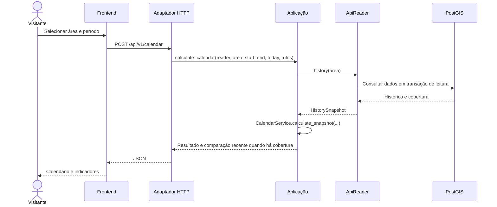
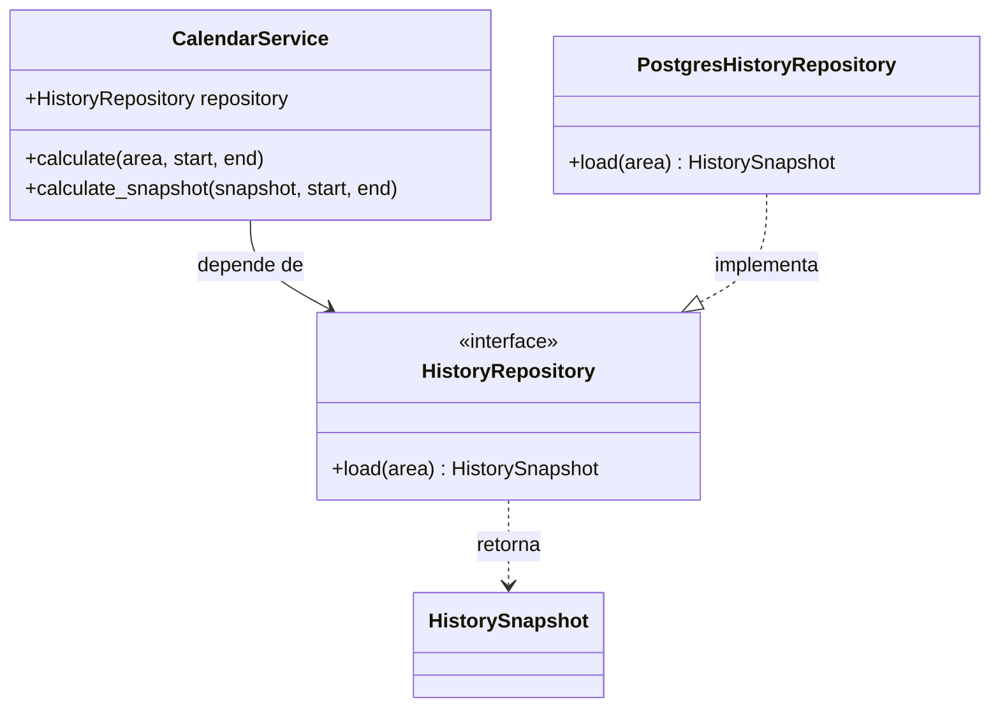

# firesync — documentação do sistema

O **firesync** transforma detecções MODIS e VIIRS do NASA FIRMS em um calendário harmonizado de focos de calor. Apoia equipes de alerta e combate a incêndios, gestores e pesquisadores na comparação entre a atividade recente e o histórico de uma área.

Síntese para desenvolvimento, testes e revisão, organizada pelos capítulos do template **Projeto de Software — UFU (2026), PDSI2.pdf** fornecido para esta documentação. Os requisitos e as decisões específicas permanecem nos documentos vinculados; exemplos genéricos do template foram adaptados à implementação do projeto.

**Aplicação:** [firesync.nogranlabs.com.br](https://firesync.nogranlabs.com.br) · **API:** [firesync-api.nogranlabs.com.br](https://firesync-api.nogranlabs.com.br).

Antes de contribuir, leia [CLAUDE.md](CLAUDE.md), [premiação](docs/premiacao.md) e o [índice com a ordem de leitura](docs/indice-documentacao.md). Esta documentação contribui para **Validity** e **Presentation**.

## 1. Requisitos de sistema

Escopo: consulta pública da cobertura disponível no Brasil, com calendário desde janeiro de 2003, atualizado pelo pipeline. Focos de calor são detecções de satélite; não equivalem à área queimada. O risco de 14 dias é uma estimativa estatística, sem garantia de ocorrência.

| Referência | Requisito principal |
| --- | --- |
| RF01–RF05 | Importar MODIS/VIIRS, harmonizar as séries e fornecer dados atualizados à aplicação. |
| RF06–RF08; RD01–RD02 | Selecionar região, desenho no mapa ou ponto/raio e período; visualizar calendário mensal. |
| RF09–RF12; RD06 | Consultar sazonalidade, ranking anual, comparação com a mediana e anomalias. |
| RF13; RD05 | Exportar análises, PNG e ZIP auditável; incluir os focos até o limite de 500 mil registros. |
| RD03–RD04; RD07–RD08 | Oferecer visualização acessível, focos recentes e prioridades pelo risco de 14 dias. |
| RNF01–RNF08 | Acesso web, fontes rastreáveis, atualização periódica, desempenho, acessibilidade, proteção contra abuso, observabilidade e CI. |

**Caso de uso central — analisar uma área:** o visitante seleciona área e período válidos; a API consulta o banco carregado; a tela apresenta calendário, indicadores e opções de exportação. Pré-condição: serviços e dados disponíveis. Pós-condição: análise vinculada à seleção. Fora da cobertura, aparece “sem dados”; entrada inválida ou excesso de pedidos produz mensagem específica, nunca zeros que simulem observações.

**Telas/protótipo:** abertura com globo → mapa e seleção → resumo recente → calendário e gráficos → Método e créditos. `lovable/` guarda o protótipo; `frontend/` contém a aplicação principal. Detalhes e critérios: [requisitos](docs/requisitos.md), [UX](docs/ux-telas.md) e [tarefas](docs/tarefas.md). O assistente do [RFC 0004](docs/rfcs/0004-assistente-virtual.md) é uma evolução planejada nesta base documental.

## 2. Projeto de software

Arquitetura hexagonal: `backend/src/domain/` concentra regras; `application/`, casos de uso; `ports/`, contratos; `adapters/`, HTTP, configuração e PostgreSQL. `data-pipeline/` importa e agrega, `frontend/` apresenta e `infra/` publica.

Interação resumida da consulta de calendário:



Recorte das classes do histórico; a rota HTTP também reutiliza `calculate_snapshot`:



**Persistência:** PostgreSQL 16 + PostGIS 3.4, com SQL parametrizado via psycopg 3 e migrations em `data-pipeline/migrations/`. `focos` guarda observações; `regioes` e `celula_regiao`, o recorte espacial; `cobertura` e `dias_sem_dados`, a disponibilidade; fatores e agregados sustentam o histórico; `risco_celulas` armazena notas pré-calculadas. H3 usa resolução 6 na agregação e 4 no risco. A leitura da API usa transação `REPEATABLE READ READ ONLY` em UTC.

**Ferramentas:** Python 3.12/FastAPI compartilham o ecossistema geoespacial do pipeline; React/TypeScript/Vite organizam a interface; Leaflet/Geoman tratam o mapa; D3/SVG desenham gráficos; GSAP/three.js compõem a abertura. Git/GitHub, Docker Compose e GitHub Actions sustentam colaboração, execução e CI. Fontes: [arquitetura](docs/arquitetura.md) e [banco](docs/banco.md).

## 3. Versionamento

Git e GitHub mantêm o histórico. O fluxo documentado usa branches de trabalho a partir de `main` e integração por PR; não exige o Git Flow completo com uma branch `develop`. Commits seguem Conventional Commits, por exemplo `docs: descreve requisitos do sistema`.

SemVer usa `MAJOR.MINOR.PATCH`: `fix` incrementa PATCH, `feat` incrementa MINOR e quebra de contrato é marcada com `!` (antes de 1.0, incrementa MINOR). `docs` não gera nova versão por si só. Tags e releases são criadas pelo workflow **Release**, a partir de `main`. Contrato `/api/v1`, regras e dados possuem versionamento próprio. Referência: [versionamento](docs/versionamento.md).

Fluxo básico: `git fetch origin` → `git switch -c docs/minha-tarefa origin/main` → `git add README.md` → `git commit -m "docs: descreve alteração"` → `git push -u origin docs/minha-tarefa`. Configure nome/e-mail locais antes do primeiro commit; não reutilize uma branch cujo PR já foi mergeado.

## 4. Deploy e ambientes

O front estático fica no Cloudflare; PostgreSQL/PostGIS, API, job NRT, job de risco e Cloudflare Tunnel ficam na VPS. O compose não publica portas dos serviços para a internet. A API usa um usuário de banco somente para leitura.

**Publicação:** compilar o front; configurar variáveis de build e runtime; subir apenas o banco na primeira carga; restaurar e conferir os dados; criar permissões; iniciar os demais serviços; validar endpoints e uma consulta real. Segredos ficam no ambiente, conforme [deploy](docs/deploy.md) e [roteiro do banco](docs/banco.md).

**Ambientes:** desenvolvimento local com Vite/API; integração com PostGIS descartável e dados sintéticos; produção nos endereços acima. Não há homologação permanente separada documentada. Use versões compatíveis com os manifests, lockfiles e imagens do projeto; valide atualizações no CI antes de publicar.

## 5. QA

| Validação | Evidência prevista no repositório |
| --- | --- |
| Requisitos e regressão | Testes de domínio, contratos HTTP, Vitest e casos de regressão antes das correções. |
| Integração | PostGIS descartável, migrations, pipeline e repositórios da API. |
| Jornadas e aceitação | Playwright em desktop/celular e conferência da carga real pelo roteiro M2. |
| Desempenho e smoke | Medição das consultas no banco real; health, calendário, mapa e exportação após deploy. |

Processo: identificar requisito e critério → preparar dados e teste → executar → corrigir e repetir a regressão → registrar resultado no PR. Entrada: contrato e ambiente definidos. Saída: verificações aplicáveis aprovadas, falhas e limitações explicitadas e revisão concluída.

A CI exige cobertura mínima de **97,1% no backend**; o pipeline usa o limite de sua `.coveragerc`. PRs apenas de Markdown dispensam as suítes de código pela regra da esteira. Cobertura, falhas, latência e atualização dos dados são evidências distintas. Detalhes: [testes](docs/testes.md) e [validação com dados reais](docs/validacao-api-eduardo.md).

## 6. Processo de integração

Fluxo de dados: **NASA FIRMS → importação e filtros → PostgreSQL/PostGIS → calibração/agregação → API REST/JSON → frontend**. Biomas vêm do IBGE; INPE fornece referências de validação; NASA GIBS fornece o mapa base. O modelo de risco roda no pipeline e a API lê suas notas.

| Rota em `/api/v1` | Responsabilidade |
| --- | --- |
| `GET /health` e `GET /regions` | Metadados de disponibilidade e regiões cadastradas. |
| `POST /calendar` | Histórico harmonizado, indicadores e comparação recente. |
| `GET /detections/recent` | Focos no recorte e janela escolhidos; alerta e risco quando disponíveis. |
| `POST /export` | ZIP com resultados, contagens, fatores, metadados e focos quando permitidos. |

Uma integração começa pelo [contrato da API](docs/api.md) e pelo [JSON de exemplo](docs/api-exemplo.json); segue com implementação dos adaptadores, testes de contrato e integração, validação no front e publicação. Quebras exigem coordenação entre as frentes e atualização do contrato. A arquitetura utiliza jobs em lote e HTTP, sem ESB ou iPaaS documentados.

## 7. Segurança de software

A API valida área/período, limita o corpo a 1.000.000 bytes, usa SQL parametrizado, CORS com origem configurada e rate limit por IP. Erros internos retornam mensagens genéricas. O IP encaminhado só deve ser confiado atrás do proxy que sobrescreve o cabeçalho.

Credenciais ficam em variáveis de ambiente e `.env` não versionado; valores `VITE_` são públicos. A API roda como usuário sem privilégio no container e só lê o banco. Cloudflare Tunnel, HTTPS e os headers CSP/HSTS complementam a proteção. Dependências devem ser revisadas antes de atualizações; esses controles não constituem certificação OWASP. Fontes: [deploy](docs/deploy.md), [API](backend/README.md) e [headers do front](frontend/public/_headers).

<a id="regras-que-não-mudam-sem-falar-com-a-equipe"></a>

## 8. Melhores práticas

Aplicar KISS, DRY e SOLID: cálculos puros no domínio, casos de uso com responsabilidade definida e dependência de portas, mantendo SQL/HTTP nos adaptadores. Preservar cenários até a mediana e P5–P95; usar a interseção dos anos de calibração; distinguir zero, ausência de cobertura e mês incompleto.

A série harmonizada usa Aqua em jan/2003–jan/2012, S-NPP em fev/2012–out/2026 e NOAA-20 desde nov/2026: um VIIRS por período, sem somar sensores. Aplicam-se os filtros de confiança nominal/alta e `type = 0` (ausente no NRT é admitido); os fatores são congelados após a calibração histórica.

Código e contrato público usam inglês; tabelas e colunas do banco seguem os nomes em português do modelo de dados; datas são UTC. Ruff, Vulture e TypeScript verificam problemas de código. As regras científicas pertencem à equipe e estão em [decisões da harmonização](docs/decisoes-harmonizacao.md) e [importação de regiões](docs/importacao-regioes.md).

## 9. Usabilidade

A interface prioriza **situação atual → contexto histórico → detalhes**. O usuário escolhe a área, lê um resumo em linguagem simples e pode aprofundar a análise ou exportar os resultados. Controles avançados ficam em “More options”.

A paleta cividis, rótulos, hachuras, bordas e navegação por teclado evitam depender apenas da cor. Desktop e celular têm jornadas próprias. O sistema identifica dados de demonstração, desatualização e falta de cobertura; o nível de alerta sazonal é distinto do risco dos próximos 14 dias. Veja [UX](docs/ux-telas.md) e [frontend](frontend/README.md).

## 10. Integração e fluxo de trabalho

1. **Entrada:** consultar requisito, tarefa e contrato; combinar alterações entre as frentes; criar branch a partir de `main`.
2. **Execução:** escrever testes antes de código novo ou correções, implementar por responsabilidade e atualizar documentação afetada.
3. **Entrega:** executar verificações pertinentes, fazer commits por etapa, enviar a branch e solicitar revisão por PR. Integrar somente após os checks e a revisão aplicáveis.

As responsabilidades e pendências ficam em [tarefas](docs/tarefas.md). A documentação formal sintetiza decisões existentes; mudanças de método ou contrato exigem discussão com os responsáveis.

## 11. Checklist de code review

- [ ] Requisito e escopo identificados; texto consistente com o contrato e a implementação.
- [ ] Responsabilidades separadas; regras científicas e cenários preservados.
- [ ] Entradas, consultas, segredos, limites e mensagens de erro revisados.
- [ ] Testes pertinentes executados; resultados, limitações e impacto de desempenho registrados.
- [ ] Operação, atualização dos dados e instruções de deploy conferidas quando afetadas.
- [ ] Links, exemplos, créditos e uso de IA atualizados; aprovação dos responsáveis solicitada.

## 12. Anexo técnico: ambiente de desenvolvimento

Pré-requisitos: Python 3.12, Node.js 20 (versão da CI), npm e PostGIS; Docker é utilizado nos testes com banco. Na raiz:

```bash
python -m venv .venv
source .venv/bin/activate
python -m pip install -r backend/requirements-dev.txt
npm --prefix frontend ci
# Configure DATABASE_URL para um PostGIS com migrations e dados válidos.
python -m uvicorn backend.adapters.inbound.http.app:create_app --factory --host 127.0.0.1 --port 8000
```

Em outro terminal: `cd frontend` e `VITE_DEV_API_PROXY=http://127.0.0.1:8000 npm run dev`. Para verificar: `python -m pytest backend/tests -q`, `npm --prefix frontend test` e `npm --prefix frontend run build`. Testes de integração exigem `TEST_DATABASE_URL` apontando para banco descartável; o teste HTTP ao vivo exige `API_URL`.

O gerador `backend/scripts/demo_data.py` é exclusivo de banco vazio e descartável com nome terminado em `_test` ou `_demo`. Instalação do pipeline, carga sintética e Playwright: [backend](backend/README.md), [pipeline](data-pipeline/README.md) e [testes](docs/testes.md).

## Uso de IA

| Parte | Ferramenta | Como foi usada |
| --- | --- | --- |
| Documentação formal deste README | OpenAI Codex | Síntese do template PDSI2 e das fontes do repositório, com rastreabilidade de requisitos e diagramas; submetida à revisão da equipe. |
| Contribuições anteriores | Diversas, discriminadas no histórico | Registro integral preservado em [docs/uso-de-ia.md](docs/uso-de-ia.md). |
