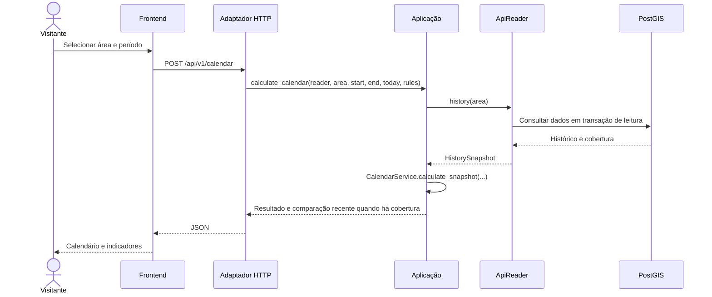
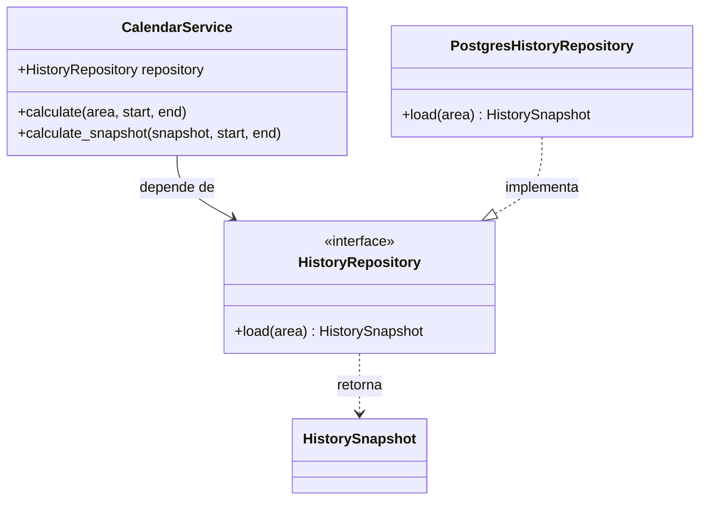

# firesync — documentação do sistema

O **firesync** transforma detecções MODIS e VIIRS do NASA FIRMS em um calendário harmonizado de focos de calor. Apoia equipes de alerta e combate a incêndios, gestores e pesquisadores na comparação entre a atividade recente e o histórico de uma área.

Síntese para desenvolvimento, testes e revisão, organizada pelos capítulos do template **Projeto de Software — UFU (2026), PDSI2.pdf** fornecido para esta documentação. Os requisitos e as decisões específicas permanecem nos documentos vinculados; exemplos genéricos do template foram adaptados à implementação do projeto.

**Aplicação:** [firesync.nogranlabs.com.br](https://firesync.nogranlabs.com.br) · **API:** [firesync-api.nogranlabs.com.br](https://firesync-api.nogranlabs.com.br).

Antes de contribuir, leia [CLAUDE.md](CLAUDE.md), [premiação](docs/premiacao.md) e o [índice com a ordem de leitura](docs/indice-documentacao.md). Esta documentação contribui para **Validity** e **Presentation**.

## 1. Requisitos de sistema

Escopo: consulta pública da cobertura disponível no Brasil, com calendário desde janeiro de 2003, atualizado pelo pipeline. Focos de calor são detecções de satélite; não equivalem à área queimada. O risco de 14 dias é uma estimativa estatística, sem garantia de ocorrência.

| Referência | Requisito principal |
| --- | --- |
| RF01–RF05 | Importar MODIS/VIIRS, harmonizar as séries e fornecer dados atualizados à aplicação. |
| RF06–RF08; RD01–RD02 | Selecionar região, desenho no mapa ou ponto/raio e período; visualizar calendário mensal. |
| RF09–RF12; RD06 | Consultar sazonalidade, ranking anual, comparação com a mediana e anomalias. |
| RF13; RD05 | Exportar análises, PNG e ZIP auditável; incluir os focos até o limite de 500 mil registros. |
| RD03–RD04; RD07–RD08 | Oferecer visualização acessível, focos recentes e prioridades pelo risco de 14 dias. |
| RNF01–RNF08 | Acesso web, fontes rastreáveis, atualização periódica, desempenho, acessibilidade, proteção contra abuso, observabilidade e CI. |

**Caso de uso central — analisar uma área:** o visitante seleciona área e período válidos; a API consulta o banco carregado; a tela apresenta calendário, indicadores e opções de exportação. Pré-condição: serviços e dados disponíveis. Pós-condição: análise vinculada à seleção. Fora da cobertura, aparece “sem dados”; entrada inválida ou excesso de pedidos produz mensagem específica, nunca zeros que simulem observações.

**Telas/protótipo:** abertura com globo → mapa e seleção → resumo recente → calendário e gráficos → Método e créditos. `lovable/` guarda o protótipo; `frontend/` contém a aplicação principal. Detalhes e critérios: [requisitos](docs/requisitos.md), [UX](docs/ux-telas.md) e [tarefas](docs/tarefas.md). O assistente do [RFC 0004](docs/rfcs/0004-assistente-virtual.md) é uma evolução planejada nesta base documental.

## 2. Projeto de software

Arquitetura hexagonal: `backend/src/domain/` concentra regras; `application/`, casos de uso; `ports/`, contratos; `adapters/`, HTTP, configuração e PostgreSQL. `data-pipeline/` importa e agrega, `frontend/` apresenta e `infra/` publica.

Interação resumida da consulta de calendário:

Recorte das classes do histórico; a rota HTTP também reutiliza `calculate_snapshot`:

**Persistência:** PostgreSQL 16 + PostGIS 3.4, com SQL parametrizado via psycopg 3 e migrations em `data-pipeline/migrations/`. `focos` guarda observações; `regioes` e `celula_regiao`, o recorte espacial; `cobertura` e `dias_sem_dados`, a disponibilidade; fatores e agregados sustentam o histórico; `risco_celulas` armazena notas pré-calculadas. H3 usa resolução 6 na agregação e 4 no risco. A leitura da API usa transação `REPEATABLE READ READ ONLY` em UTC.

**Ferramentas:** Python 3.12/FastAPI compartilham o ecossistema geoespacial do pipeline; React/TypeScript/Vite organizam a interface; Leaflet/Geoman tratam o mapa; D3/SVG desenham gráficos; GSAP/three.js compõem a abertura. Git/GitHub, Docker Compose e GitHub Actions sustentam colaboração, execução e CI. Fontes: [arquitetura](docs/arquitetura.md) e [banco](docs/banco.md).

## 3. Versionamento

Git e GitHub mantêm o histórico. O fluxo documentado usa branches de trabalho a partir de `main` e integração por PR; não exige o Git Flow completo com uma branch `develop`. Commits seguem Conventional Commits, por exemplo `docs: descreve requisitos do sistema`.

SemVer usa `MAJOR.MINOR.PATCH`: `fix` incrementa PATCH, `feat` incrementa MINOR e quebra de contrato é marcada com `!` (antes de 1.0, incrementa MINOR). `docs` não gera nova versão por si só. Tags e releases são criadas pelo workflow **Release**, a partir de `main`. Contrato `/api/v1`, regras e dados possuem versionamento próprio. Referência: [versionamento](docs/versionamento.md).

Fluxo básico: `git fetch origin` → `git switch -c docs/minha-tarefa origin/main` → `git add README.md` → `git commit -m "docs: descreve alteração"` → `git push -u origin docs/minha-tarefa`. Configure nome/e-mail locais antes do primeiro commit; não reutilize uma branch cujo PR já foi mergeado.

## 4. Deploy e ambientes

O front estático fica no Cloudflare; PostgreSQL/PostGIS, API, job NRT, job de risco e Cloudflare Tunnel ficam na VPS. O compose não publica portas dos serviços para a internet. A API usa um usuário de banco somente para leitura.

**Publicação:** compilar o front; configurar variáveis de build e runtime; subir apenas o banco na primeira carga; restaurar e conferir os dados; criar permissões; iniciar os demais serviços; validar endpoints e uma consulta real. Segredos ficam no ambiente, conforme [deploy](docs/deploy.md) e [roteiro do banco](docs/banco.md).

**Ambientes:** desenvolvimento local com Vite/API; integração com PostGIS descartável e dados sintéticos; produção nos endereços acima. Não há homologação permanente separada documentada. Use versões compatíveis com os manifests, lockfiles e imagens do projeto; valide atualizações no CI antes de publicar.

## Uso de IA

| Parte | Ferramenta | Como foi usada |
| --- | --- | --- |
| Documentação formal deste README | OpenAI Codex | Síntese do template PDSI2 e das fontes do repositório, com rastreabilidade de requisitos e diagramas; submetida à revisão da equipe. |
| Contribuições anteriores | Diversas, discriminadas no histórico | Registro integral preservado em [docs/uso-de-ia.md](docs/uso-de-ia.md). |
