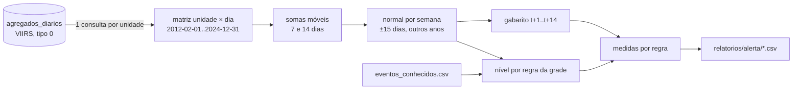

# RFC 0001: Backtest do nível de alerta (solução A + B)
- **Status:** Implementado no PR #56 (primeira rodada no banco de teste). A frente B respondeu às perguntas em 15/11/2026 (piso contínuo). Falta levar a `v1` ao `alert_rules.json` e à API
- **Autor:** Eduardo
- **Data:** 2026-11-14

Critério que melhora (ver [premiacao.md](../premiacao.md)): **Validity**. A tela de Método passa a mostrar um número medido sobre o alerta, com o limite declarado. A solução B ajuda também na **Presentation**, com a antecedência de uma crise real no vídeo.

## Contexto e problema

O nível de alerta (Normal / Atenção / Crítico) sai da regra do `config/alert_rules.json` (hoje a `0.2`), que ainda não foi calibrada. O [validacao-alerta.md](../validacao-alerta.md) define **o que** medir: teste retroativo de 2013 a 2024, gabarito "14 dias seguintes acima do P90 do normal" e ganho sobre uma regra ingênua. A revisão do Mateus no PR #42 fixou três pontos: o ganho é o número que decide, as janelas não podem se sobrepor e o texto da tela tem que dizer o que foi medido.

Este RFC define **como** implementar: arquivos, consultas, contas e testes.

## Objetivos / Não-objetivos

**Objetivos**
- `data-pipeline/validacao/backtest_alerta.py`: só **lê** o banco e gera `relatorios/alerta/backtest.csv`, `por_bioma.csv` e `eventos.csv`.
- `data-pipeline/tests/test_backtest_alerta.py`: autoteste sem banco (pytest), com dados inventados. Fica em `tests/` para rodar na esteira e contar na cobertura. Inclui o caso de sobreposição das janelas.
- `data-pipeline/referencia/eventos_conhecidos.csv`: crises com data, lugar e **fonte oficial**.

**Não-objetivos**
- Escolher a `v1`. Isso é da frente B, pela tabela e pela regra de decisão do [validacao-alerta.md](../validacao-alerta.md).
- Gravar no banco, criar migration ou mudar o `alert_rules.json`.
- Área queimada (MCD64A1), que fica como próximo passo.
- Ligar o script à API. A frente C lê a `v1` do `alert_rules.json`, como já está previsto.

## Proposta

### Fluxo



### 1. Leitura (única parte com banco)

Uma consulta para as unidades res 4 e uma para os biomas. O `agregados_diarios` já tem só um VIIRS por período (S-NPP de 2012-02 a 2024-12) e só `tipo = 0` ([agregar.py](../../data-pipeline/agregar.py), linhas 44 a 51), então não precisa de filtro de satélite nem de tipo.

A célula-mãe res 4 sai por conta de bits, sem extensão H3 no Postgres: troca a resolução para 4 e preenche os dígitos 5 e 6 com 7. A fórmula foi conferida contra o `h3.cell_to_parent` em 1.000 células do Brasil.

```sql
-- unidades res 4
SELECT ((h3 & ~(15::bigint << 52)) | (4::bigint << 52) | (63::bigint << 27)) AS unidade,
       data, sum(focos_brutos) AS n
FROM agregados_diarios
WHERE data >= '2012-02-01' AND data < '2025-01-01'
GROUP BY 1, 2;

-- biomas
SELECT regiao_id AS unidade, data, sum(focos_brutos) AS n
FROM agregados_diarios
WHERE data >= '2012-02-01' AND data < '2025-01-01'
GROUP BY 1, 2;
```

O resultado vira uma matriz densa `int32[unidade, dia]` com zero onde não há linha (~5 mil × 4.718 dias ≈ 95 MB). Usa `pandas` e `numpy`, que já estão no `requirements.txt`. Nenhuma dependência nova.

### 2. Contas (funções puras, sem banco)

Tudo em `numpy`, vetorizado por unidade. Para cada semana, `t` é o último dia avaliado (todo domingo de 2013-01-06 a 2024-12-15, para o gabarito caber até 2024-12-29).

| Função | Entrada → saída |
| --- | --- |
| `somas_moveis(m, k)` | matriz diária → soma dos `k` dias terminando em cada dia (`cumsum`) |
| `indices_normal(t, raio, anos, ano_excluido)` | dia `t` → índices do mesmo dia do ano, deslocado de −15 a +15, **nos outros anos** (o nível exclui o ano de `t`) |
| `indices_gabarito(t, raio, anos)` | o mesmo para o normal do gabarito, centrado em `t+14` e excluindo o ano de `t+14` (no fim de dezembro, é o ano seguinte; issue #59) |
| `normal(s, idx)` | somas móveis + índices → mediana, P75, P90 por unidade |
| `nivel(s7, s3, s3_antes, normal7, regra)` | → 0 Normal, 1 Atenção, 2 Crítico |
| `gabarito(s14_depois, p90_14, minimo=10)` | → bool "muito fogo" |
| `medidas(niveis, gabarito)` | → frequência, acerto, cobertura, alarme falso, estabilidade |
| `alerta_mesma_frequencia(score, freq_alvo)` | a ingênua com o mesmo número de alertas da regra: as `k` semanas de maior `(s7 + 1) / (P90 + 1)`. **Mudança na implementação:** o RFC previa ajustar o percentil da ingênua, mas com empates o percentil não chega à frequência exata; ordenar pelo score dá exatamente `k` alertas |

**Janelas:** as definidas em "Janelas" no [validacao-alerta.md](../validacao-alerta.md). Na matriz de somas móveis, o nível lê `s7[t]`, a tendência compara `s3[t] > s3[t−3]` e o gabarito lê `s14[t+14]`. A soma de 14 dias que termina em `t+14` começa em `t+1`.

**Nível** (regra `0.2`, com os parâmetros vindos da grade):
- **Crítico:** `s7 ≥ razao × mediana` **e** (se a tendência estiver ligada) `s3[t] > s3[t−3]`. O piso de 10 detecções (o mesmo do gabarito) roda em duas versões: **só na mediana zero** (`s7 ≥ 10` onde a mediana é zero) e **contínuo** (`s7 ≥ max(razao × mediana, 10)` sempre, sem o degrau da mediana baixa; issue #59).
- **Atenção:** não é Crítico e `s7 > P75` (ou P90, conforme a grade).
- **Normal:** o resto.

**Grade:** razão em {1,5; 2; 2,5; 3} × tendência {ligada, desligada} × Atenção em {P75, P90} × piso {só na mediana zero, contínuo} = 32 regras, com a regra do `alert_rules.json` marcada (hoje a `v1`, piso contínuo). O `eventos.csv` usa essa mesma regra, igual ao `recent` da API. O P90 e o mínimo de 10 do gabarito também rodam com {P80, P95} e {5, 20} nas duas versões do piso da regra atual, para mostrar a sensibilidade.

**Medidas por regra** (sobre todas as semanas × unidades):
- frequência de cada nível;
- acerto do Crítico = P(gabarito | Crítico);
- cobertura = P(Crítico ou Atenção | gabarito), e cobertura só do Crítico = P(Crítico | gabarito);
- alarme falso = 1 − acerto;
- estabilidade = trocas de nível por unidade por mês;
- **ganho** = acerto − acerto da ingênua na mesma frequência, no total e por ano (`anos_com_ganho_positivo`, de 12).

### 3. Saída

`data-pipeline/relatorios/alerta/`. Hoje `relatorios/` só está fora do git pelo `.git/info/exclude` local; o PR do script põe `data-pipeline/relatorios/` no `.gitignore`.

| Arquivo | Linhas | Colunas principais |
| --- | --- | --- |
| `backtest.csv` | 1 por regra da grade (+ sensibilidade) | `regra, razao, tendencia, atencao, p_gabarito, minimo, freq_normal, freq_atencao, freq_critico, acerto, cobertura, cobertura_critico, alarme_falso, trocas_mes, acerto_ingenua, ganho, anos_com_ganho_positivo` |
| `por_bioma.csv` | 1 por regra × bioma | as mesmas, nos 6 biomas inteiros |
| `eventos.csv` | 1 por evento × semana | `evento, semana, nivel, detections, typical_median` e a `antecedencia_semanas` |
| `relatorio.txt` | resumo | a regra atual com a situação dela, as regras aprovadas no critério completo (gabarito principal e as quatro variações) e as que passam no principal sem sensibilidade calculada, que não contam como aprovadas |

### 4. Eventos conhecidos (solução B)

`data-pipeline/referencia/eventos_conhecidos.csv`:

```csv
nome,regiao,inicio,fim,fonte_url,fonte_descricao
```

- Lugar = `regiao`, o nome do bioma em `regioes` (o id muda de um banco para outro). UF ou polígono menor ficam para depois.
- **Nenhuma linha sem `fonte_url` oficial** (INPE, decreto de emergência, relatório do governo). O script recusa linha sem fonte.
- Candidatos: Pantanal 2020, Amazônia ago/2019, Pantanal 2024 (início antecipado), Amazônia e Cerrado 2024.
- Antecedência = dias (e semanas cheias) entre o primeiro domingo em Atenção ou Crítico (nas 8 semanas antes do `inicio`) e o `inicio`. **Vazia** quando não houve alerta, para não se confundir com "menos de 7 dias" (issue #59).

### 5. Autoteste (`test_backtest_alerta.py`, sem banco)

Segue o padrão do `tests/test_harmonizacao.py`: pytest com dados inventados.

1. **Sobreposição (pedido do Mateus):** fogo alto só em `t−6..t` e zero depois → gabarito `False`. Se a janela do gabarito incluir `t`, o teste quebra.
2. **Sem futuro no normal:** um ano com fogo enorme não entra no normal do próprio ano.
3. **Ganho zero:** série que só persiste (cada semana igual à anterior) → ganho perto de zero sobre a ingênua.
4. **Ganho positivo:** série com um sinal que antecede o fogo e que a ingênua não vê → ganho > 0.
5. **Célula-mãe:** a fórmula de bits bate com o `h3.cell_to_parent` (o `h3` já é dependência).
6. **Evento sem fonte:** linha sem `fonte_url` levanta erro.

## Alternativas consideradas

- **Área queimada (MCD64A1) como gabarito.** É independente do VIIRS, mas custa ~11 GB, conta no Earthdata e leitura de HDF4 (~5 h). Fica para depois da submissão. Meio-termo registrado: só os blocos de um evento.
- **Rodar o backtest pela API (`recent`).** Faria a conta igual à da tela, mas a API não tem código ainda e seriam milhões de chamadas. Descartado. O risco de divergência entre o script e a API fica em "Riscos".
- **Extensão `h3-pg` para a célula-mãe.** É mais legível, mas o banco não tem a extensão e instalar mexe na imagem da frente C. A conta de bits é uma linha e está testada.
- **Normal com todos os anos (inclusive o próprio).** É mais simples, mas usa o futuro e infla o acerto. Descartado.
- **Comparar com a ingênua só no P90 fixo.** Uma regra que alerta menos ganha acerto "de graça". Descartado: a ingênua roda na mesma frequência de alerta.

## Riscos e mitigação

| Risco | Mitigação |
| --- | --- |
| Acerto inflado pela persistência do fogo | O número que decide é o ganho sobre a ingênua na mesma frequência. A primeira parte da regra de decisão foi fixada antes de rodar; o complemento da frente B veio depois e fica declarado como posterior ("Perguntas respondidas pela frente B") |
| Dia sem dado do S-NPP (falha do satélite) vira zero | Conferir a `cobertura` e listar no `relatorio.txt` os dias sem arquivo. Se houver muitos, as semanas que tocam esses dias saem do teste |
| A conta do script diverge da que a API vai fazer | O script lê os parâmetros do próprio `alert_rules.json`. Quando a frente C implementar o `recent`, um teste compara as duas contas numa unidade |
| Memória (matriz ~95 MB + somas) | `int32` e somas por bloco de unidades, se precisar |
| Mediana zero em lugares quase sem fogo | Piso contínuo de 10 detecções (ver "Perguntas respondidas pela frente B") |
| Data de evento sem fonte confiável | O script recusa a linha. O evento sai da lista em vez de entrar sem fonte |

## Plano de implementação

Plano histórico. Branch nova `a-backtest-alerta`, a partir da `main` depois do merge do PR #42. O plano previa as respostas da frente B antes da rodada; elas vieram depois (PR #56) e isso fica declarado em "Perguntas respondidas pela frente B". TDD: o teste vem antes de cada função.

0. `data-pipeline/relatorios/` no `.gitignore`.

1. **Autoteste e funções puras** (`test_backtest_alerta.py` + contas do item 2), sem banco. ~1 h.
2. **Leitura do banco e saída CSV.** Rodar no banco de teste, com o tempo e os números no PR. ~1 h.
3. **`eventos_conhecidos.csv`** com as fontes, mais o `eventos.csv` gerado. ~1 h.
4. **PR** com o `backtest.csv` colado (ou anexado), o resumo para a frente B e a linha na tabela "Uso de IA" do README. A esteira roda `ruff` e `vulture`.

## Perguntas respondidas pela frente B (Weberson, 15/11/2026)

As respostas vieram **depois** da primeira rodada (PR #56), com a tabela já vista. Fica declarado.

1. **Ganho mínimo:** não há um número fixo. Para a `v1` valer, o ganho sobre a ingênua tem de ser positivo no total, em pelo menos 7 dos 12 anos **e no total de cada variação do gabarito** da sensibilidade (P80, P95, mínimo de 5 e mínimo de 20 detecções). O critério foi fixado depois da rodada, por causa da fragilidade apontada na revisão do PR #56 (issue #59, item 5).
2. **Definição da tendência:** "últimos 3 dias > 3 dias anteriores", como este RFC e o backtest já usam. A API usa a mesma conta.
3. **Piso:** **contínuo**: Crítico exige `s7 ≥ max(razão × mediana, 10)`. Na rodada do PR #56 (razão 2, tendência ligada), ele dá ganho de +6,0 pontos contra +3,1 do piso só na mediana zero, fica positivo em todas as variações do gabarito (+1,4 com P95 e +2,0 com mínimo de 5, onde o outro dá +0,1 e −0,4) e deixa o Crítico em 2,7% das semanas, dentro da meta de 2% a 5%. O piso só na mediana zero não passa no critério 1.
4. **Semana fixa (domingo):** mantida.

**O que isso não muda:** por bioma inteiro a regra perde da ingênua em 5 de 6 biomas, com qualquer piso. A linha da tela por bioma não mostra acerto.

O piso contínuo já está no `config/alert_rules.json` e no `recent` da API (PR #69). O intervalo de confiança por bootstrap em blocos de ano, oferecido pela frente A, é bem-vindo se couber.
