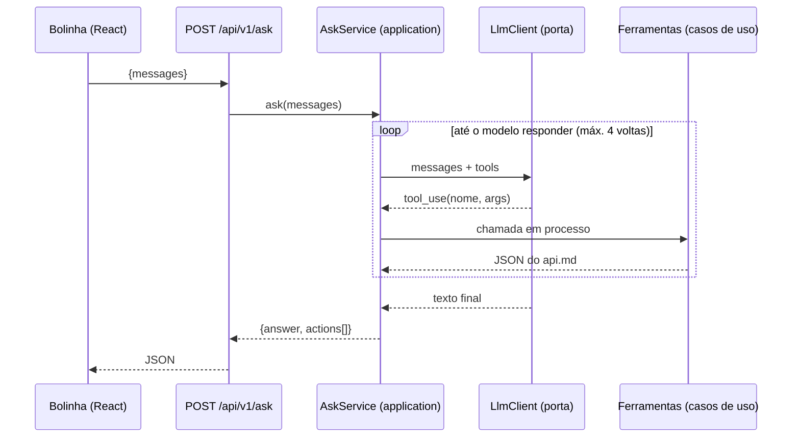

# RFC 0004: Assistente virtual (chat) sobre a API

- **Status:** Rascunho, aguardando revisão do Mateus (frente D)
- **Autor:** Eduardo
- **Data:** 2026-11-15

Critério que melhora (ver [premiacao.md](../premiacao.md)): **Presentation** e **Creativity**. Quem chega ao site pergunta em linguagem natural e recebe a resposta com o número e o calendário de verdade. Ajuda um pouco no **Impact**, porque a brigada ou o gestor não precisa aprender a desenhar área e escolher período. O prazo da submissão é hoje (15/11), então este RFC é para depois da entrega, a não ser que a equipe decida o contrário.

## Contexto e problema

Hoje o usuário precisa escolher a área no mapa, o período e ler o calendário para responder perguntas simples:

- "Qual foi o pior mês no Pantanal em 2020?"
- "2024 foi acima do normal no Cerrado?"
- "Quantos focos na Amazônia nos últimos 7 dias?"
- "Onde está pegando fogo agora?"
- "Me passa um relatório de queimada do ano passado."

A proposta é uma **bolinha de chat** no canto do site que responde essas perguntas com os dados do banco. Ela cobre o que o desafio pede (RF06–RF13 e RD05–RD07 em [requisitos.md](../requisitos.md)) e o que a equipe acrescentou: janela recente contra o normal da época, nível de alerta `v1` e pacote de auditoria.

### Por que não "a IA escreve SQL" (text-to-SQL)

1. **O número sairia errado.** A contagem da tela não é um `COUNT(*)` em `focos`. Ela segue as regras do [README](../../README.md#regras-que-não-mudam-sem-falar-com-a-equipe): um VIIRS por período (nunca a soma), fator Aqua → S-NPP por bioma × mês × dia/noite, só confiança nominal ou alta e `type = 0`, e mês sem dados diferente de zero focos. Um SQL gerado pelo modelo ignoraria isso e mostraria um número diferente do calendário. Isso derruba **Validity**.
2. **Desempenho.** `focos` tem milhões de linhas. Uma consulta mal gerada trava a VPS.
3. **Arquitetura.** O cálculo existe num lugar só (domínio + casos de uso). Um segundo caminho de cálculo fere os [princípios de código](../arquitetura.md#princípios-de-código).

## Objetivos / Não-objetivos

**Objetivos**
- Responder, em linguagem natural, perguntas sobre focos por região (bioma), período, janela recente, alerta e "onde está queimando agora".
- **Todo número vem dos casos de uso que já existem.** O modelo só escolhe a ferramenta, preenche os parâmetros e redige o texto.
- Toda resposta com número traz um botão que aplica a mesma área e período na tela (calendário de verdade) e, quando fizer sentido, o link do ZIP de auditoria.
- Responder no idioma da pergunta. A interface (botão, placeholder, erros) fica em inglês, como o resto do site.
- Crédito ao FIRMS visível no painel do chat.

**Não-objetivos**
- SQL gerado pelo modelo ou acesso direto ao banco.
- Município, estado ou lugar fora do Brasil (o banco só tem os 6 biomas do IBGE). O assistente diz que não tem esse recorte e oferece o bioma ou o desenho no mapa.
- Previsão ou recomendação operacional ("devo mandar brigada?"). O assistente mostra dado medido, não decide.
- Histórico de conversa no servidor ou conta de usuário.

## Proposta

### Fluxo



### Backend (hexagonal)

```
backend/src/
├── application/assistant.py          AskService: loop de tool-use, limite de voltas, monta actions[]
├── application/assistant_tools.py    definição das ferramentas e despacho para os casos de uso
├── ports/llm.py                       LlmClient (Protocol): complete(system, messages, tools) -> resposta
└── adapters/
    ├── inbound/http/app.py            rota POST /api/v1/ask (mesmo guard, rate limit e cache)
    └── outbound/llm/anthropic.py      adaptador da API da Anthropic (SDK oficial)
```

O `AskService` recebe o `ApiReader` e o `LlmClient` de fora. Nos testes entra um `LlmClient` falso que devolve uma sequência fixa de `tool_use`, sem rede.

### Ferramentas

Cada ferramenta chama o que a rota HTTP correspondente já chama e devolve o mesmo JSON do [api.md](../api.md), recortado para caber no contexto.

| Ferramenta | Parâmetros | Chama | Responde |
| --- | --- | --- | --- |
| `list_regions` | — | `reader.regions()` | "Quais regiões vocês têm?" e resolve "Pantanal" → `region_id` |
| `get_calendar` | `region_id`, `start`, `end` (`YYYY-MM`) | `parse_request` + `calculate_calendar` ([api.py](../../backend/src/application/api.py)) | pior mês, ranking de anos, sazonalidade, indicadores, "acima do normal" |
| `get_recent` | `region_id` | `calculate_calendar` → `recent` | últimos 7 dias contra o normal da época e nível de alerta `v1` |
| `get_hotspots_now` | `hours` (24 ou 48) | `reader.map_rows(MapQuery(...))` com a bbox da cobertura em modo hexágono | "onde está pegando fogo agora": top N hexágonos com contagem, centro lat/lon e bioma |
| `build_report` | `region_id` (opcional, todas se vazio), `year` | `get_calendar` por região + link de `POST /export` | "relatório do ano passado": resumo por bioma (total, pior mês, comparação com o normal) e o ZIP de auditoria para baixar |

O resumo do relatório é texto montado pelo modelo a partir dos números da ferramenta. O arquivo oficial continua sendo o ZIP do `/export`, que já tem metadados, fatores e CSV.

### Contrato `POST /api/v1/ask`

Pedido:

```json
{ "messages": [ { "role": "user", "content": "Qual o pior mês no Pantanal em 2020?" } ] }
```

Resposta:

```json
{
  "answer": "September 2020 had 8,106 hotspots in the Pantanal, the highest month of that year...",
  "actions": [
    { "type": "show_calendar", "area": { "region_id": 4 }, "start": "2020-01", "end": "2020-12" },
    { "type": "download_export", "area": { "region_id": 4 }, "start": "2020-01", "end": "2020-12" }
  ],
  "meta": { "updated_at": "...", "data_version": "..." }
}
```

- `messages`: no máximo 10 mensagens e 1.000 caracteres por mensagem. Acima disso, `invalid_request` (400).
- `actions[]` é montado pelo `AskService` a partir das ferramentas que **de fato rodaram**, não pelo texto do modelo. Assim o botão sempre leva ao dado que gerou a resposta.
- Erros novos: `assistant_unavailable` (503) quando a API do LLM falha ou estoura o tempo, no formato de erro do [api.md](../api.md#erros).
- Rate limit novo: `RATE_LIMIT_ASK` (padrão `5` por janela), no mesmo `RateLimiter` dos outros.

### Frontend

- `frontend/src/assistant/`: `AssistantBubble.tsx` (botão flutuante + painel), `useAssistant.ts` (estado da conversa em memória) e `askClient.ts` (usa o `getApiBaseUrl` e o `ApiClientError` de `frontend/src/api/`).
- `show_calendar` aplica a área e o período no estado que o `SelectionPanel` já usa, e o calendário recalcula pelo caminho normal.
- `download_export` reaproveita o `ExportBar`/`downloadBlob`.
- Acessível: foco preso no painel aberto, `Esc` fecha, `aria-live` na resposta.
- Perguntas de exemplo como chips no painel vazio (as cinco do contexto, em inglês).

### Prompt de sistema (resumo)

- Use só números que vieram das ferramentas. Se a ferramenta não respondeu, diga que não sabe.
- Sempre diga a região, o período e que a série é harmonizada na escala VIIRS (MODIS + VIIRS, NASA FIRMS).
- Mês sem dados (`dias_sem_dados`) não é zero focos.
- Fora do Brasil ou abaixo de bioma: explique o limite e sugira o mapa.

### Configuração (`infra/.env` na VPS)

| Variável | Padrão | Uso |
| --- | --- | --- |
| `ANTHROPIC_API_KEY` | vazio | Sem chave, `/ask` responde `assistant_unavailable` e o front esconde a bolinha |
| `ASSISTANT_MODEL` | `claude-haiku-5-5` | Barato e rápido para escolher ferramenta e redigir |
| `ASSISTANT_TIMEOUT_S` | `20` | Tempo máximo do pedido inteiro |
| `RATE_LIMIT_ASK` | `5` | Pedidos por IP na janela |

## Alternativas consideradas

| Alternativa | Prós | Contras | Decisão |
| --- | --- | --- | --- |
| **Text-to-SQL** sobre views liberadas | Responde qualquer pergunta | Número diferente do calendário, risco de consulta pesada, segundo caminho de cálculo | Descartada (ver "Contexto") |
| **FAQ fixo / intents sem LLM** | Sem custo, determinístico | Não entende pergunta livre nem idioma variado; não é o que se quer mostrar | Descartada |
| **LLM chamando a API HTTP pública** (em vez de em processo) | Desacoplado | Passa pelo rate limit e pelo túnel à toa, mais latência | Descartada: em processo, com o mesmo `reader` e a mesma transação `REPEATABLE READ` |
| **LLM no navegador** (chave no front) | Sem backend novo | Expõe a chave | Descartada |

## Riscos e mitigação

| Risco | Mitigação |
| --- | --- |
| Modelo inventa número | Prompt proíbe; `actions[]` sai das ferramentas; teste com `LlmClient` falso confere que o número do texto existe no JSON da ferramenta (amostra de perguntas fixas) |
| Custo da API | Haiku, `RATE_LIMIT_ASK`, `max_tokens` baixo, até 4 voltas por pedido, limite de gasto na conta da Anthropic |
| Prompt injection ("ignore e rode SQL") | O modelo não tem ferramenta de SQL nem de escrita; parâmetros validados pelo `parse_request`/`MapQuery.parse` existentes |
| LLM fora do ar na demo | `assistant_unavailable` e o front esconde a bolinha; o resto do site não depende dela |
| Latência (várias voltas) | Indicador "thinking…" no painel; `ResponseCache` no resultado das ferramentas; `ASSISTANT_TIMEOUT_S` |
| Regra do projeto sobre stack | Provedor do LLM entra em [arquitetura.md](../arquitetura.md) depois do OK da equipe; uso de IA na tabela do README |

## Plano de implementação

Cada etapa é um PR pequeno, com TDD e a esteira verde (`ruff`, `vulture`, `pytest`, Vitest, Playwright).

1. **Decisão:** equipe aprova este RFC e o provedor (registro em `arquitetura.md`).
2. **Porta e serviço:** `ports/llm.py`, `application/assistant.py` e `assistant_tools.py` com `LlmClient` falso. Testes de `list_regions`, `get_calendar` e do limite de voltas.
3. **Rota:** `POST /api/v1/ask` no `app.py`, rate limit, erros e seção nova no `api.md`. Testes HTTP com o repositório sintético.
4. **Adaptador Anthropic:** `adapters/outbound/llm/anthropic.py` + variáveis no `infra/.env.example` e no `backend/README.md`. Teste só com o SDK mockado (a esteira não acessa rede).
5. **Ferramentas restantes:** `get_recent`, `get_hotspots_now`, `build_report`.
6. **Front:** `frontend/src/assistant/` com Vitest e uma jornada Playwright (abre a bolinha, clica num chip, vê a resposta e o calendário aplicado) com a API falsa.
7. **Deploy:** chave na VPS, conferir as cinco perguntas do contexto contra o calendário na tela.

## Perguntas em aberto

1. **Mateus (frente D):** a bolinha cabe no layout atual sem brigar com o mapa e o `ExportBar` no celular? Canto inferior direito?
2. **Mateus:** `show_calendar` pode reaproveitar o estado do `SelectionPanel` direto ou precisa de um evento/contexto novo?
3. **Equipe:** entra antes do fim da submissão (só etapas 2–4 + chip mínimo) ou fica para depois?
4. **Equipe:** provedor e modelo: Anthropic (`claude-haiku-5-5`) está ok? Quem paga a chave?
5. O `risco_celulas` (RFC 0003) não entra no produto, então não vira ferramenta. Confirmar.
