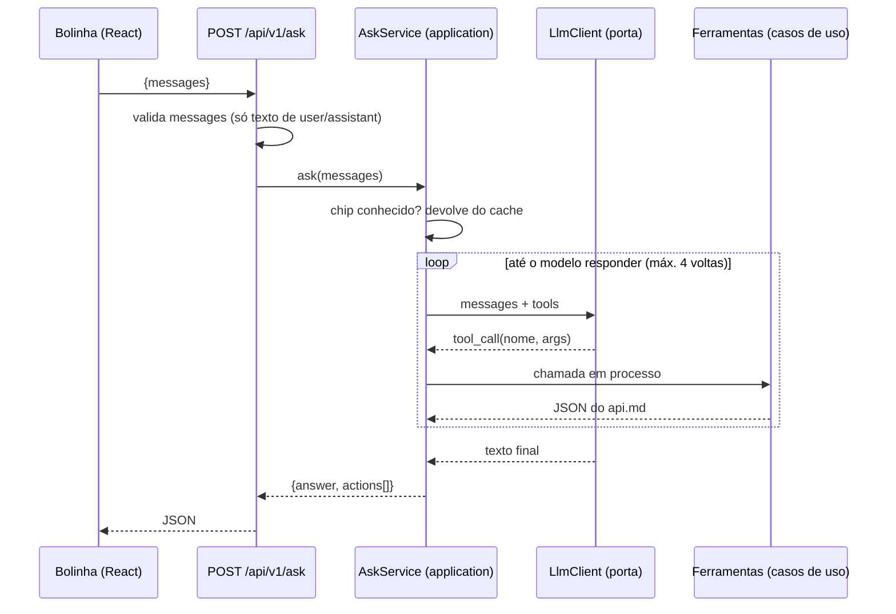

# RFC 0004: Assistente virtual (chat) sobre a API

- **Status:** Aprovado no PR #121 (revisão do Mateus aplicada). Entra **antes da submissão**, no escopo mínimo da seção "Plano" (tarefas C11 e D11)
- **Autor:** Eduardo
- **Data:** 2026-11-15

Critério que melhora (ver [premiacao.md](../premiacao.md)): **Presentation** e **Creativity**. Quem chega ao site pergunta em linguagem natural e recebe a resposta com o número e o calendário de verdade. Ajuda um pouco no **Impact**, porque a brigada ou o gestor não precisa aprender a desenhar área e escolher período.

## Contexto e problema

Hoje o usuário precisa escolher a área no mapa, o período e ler o calendário para responder perguntas simples:

- "What was the worst month in the Pantanal in 2020?"
- "Was 2024 above normal in the Cerrado?"
- "How many hotspots in the Amazon in the last 7 days?"
- "Where is it burning right now?" / "Where is fire likely in the next 14 days?"
- "Give me a fire report for last year."

A proposta é uma **bolinha de chat** no canto do site que responde essas perguntas com os dados do banco. Ela cobre o que o desafio pede (RF06–RF13 e RD05–RD07 em [requisitos.md](../requisitos.md)) e o que a equipe acrescentou: janela recente contra o normal da época, nível de alerta `v1`, risco dos próximos 14 dias ([RFC 0003](0003-modelo-risco.md)) e pacote de auditoria.

### Por que não "a IA escreve SQL" (text-to-SQL)

1. **O número sairia errado.** A contagem da tela não é um `COUNT(*)` em `focos`. Ela segue as regras do [README](../../README.md#regras-que-não-mudam-sem-falar-com-a-equipe): um VIIRS por período (nunca a soma), fator Aqua → S-NPP por bioma × mês × dia/noite, só confiança nominal ou alta e `type = 0`, e mês sem dados diferente de zero focos. Um SQL gerado pelo modelo ignoraria isso e mostraria um número diferente do calendário. Isso derruba **Validity**.
2. **Desempenho.** `focos` tem milhões de linhas. Uma consulta mal gerada trava a VPS.
3. **Arquitetura.** O cálculo existe num lugar só (domínio + casos de uso). Um segundo caminho de cálculo fere os [princípios de código](../arquitetura.md#princípios-de-código).

## Objetivos / Não-objetivos

**Objetivos**
- Responder, em linguagem natural, perguntas sobre focos por região (bioma), período, janela recente, alerta, risco dos próximos 14 dias e "onde está queimando agora".
- **Todo número vem dos casos de uso que já existem.** O modelo só escolhe a ferramenta, preenche os parâmetros e redige o texto.
- Toda resposta com número traz um botão que aplica a mesma área e período na tela (calendário de verdade) e, quando fizer sentido, o download do ZIP de auditoria.
- **Responde no idioma da pergunta.** Decisão do Eduardo em 15/11/2026, registrada como exceção na regra de idioma do [CLAUDE.md](../../CLAUDE.md#regras-de-código): o jurado pergunta em inglês e recebe em inglês; a brigada pergunta em português e recebe em português. O texto fixo do painel (botão, placeholder, chips, erros) continua em inglês.
- Crédito ao NASA FIRMS visível no painel do chat.
- **Continua respondendo quando a cota do provedor acaba** (ver "Provedores e cota").

**Não-objetivos**
- SQL gerado pelo modelo ou acesso direto ao banco.
- Município, estado ou lugar fora do Brasil (o banco só tem os 6 biomas do IBGE). O assistente diz que não tem esse recorte e sugere o desenho no mapa.
- Recomendação operacional ("devo mandar brigada?"). O assistente mostra dado medido e a frequência histórica do risco, não decide.
- Histórico de conversa no servidor ou conta de usuário. O chat fica aberto, sem login, para os jurados testarem.

## Proposta

### Fluxo



### Backend (hexagonal)

```
backend/src/
├── application/assistant.py          AskService: loop de tool-use, limite de voltas, teto diário, monta actions[]
├── application/assistant_tools.py    definição das ferramentas e despacho para os casos de uso
├── ports/llm.py                       LlmClient (Protocol): complete(system, messages, tools) -> resposta
└── adapters/
    ├── inbound/http/app.py            rota POST /api/v1/ask (mesmo guard, rate limit e cache)
    └── outbound/llm/openai.py         adaptador do formato OpenAI chat completions, com lista de provedores
```

O `AskService` recebe o `ApiReader` e o `LlmClient` de fora. Nos testes entra um `LlmClient` falso que devolve uma sequência fixa de chamadas de ferramenta, sem rede.

### Ferramentas

Cada ferramenta chama o que a rota HTTP correspondente já chama e devolve o mesmo JSON do [api.md](../api.md), recortado para caber no contexto.

| Ferramenta | Parâmetros | Chama | Responde |
| --- | --- | --- | --- |
| `list_regions` | — | `reader.regions()` | "Which regions do you cover?" e resolve "Pantanal" → `region_id` |
| `get_calendar` | `region_id`, `start`, `end` (`YYYY-MM`, opcionais) | `parse_request` + `calculate_calendar` ([api.py](../../backend/src/application/api.py)) | pior mês, ranking de anos, sazonalidade, indicadores, "above normal" |
| `get_recent` | `region_id` | `calculate_calendar` sem `start`/`end`, ou seja, o padrão do contrato: `2003-01` a `last_month` ([api.md](../api.md#start-e-end)); usa só o bloco `recent` | últimos 7 dias contra o normal da época e nível de alerta `v1` |
| `get_fire_map` | `hours` (`24`, `72` ou `168`, como em [api.md](../api.md#get-detectionsrecent)) | `MapQuery.parse` + `reader.map_rows` com a bbox da cobertura em modo `hexagons` | "Where is it burning now?": top N hexágonos com contagem, centro e bioma. "Where is fire likely?": `alerts.priority[]` com `risk_tier`/`risk_prob` e a legenda `alerts.risk.tiers[]` com `historical_share` |
| `build_report` | `region_id` (opcional, todas se vazio), `year` | `get_calendar` por região + ação `download_export` | "Report for last year": resumo por bioma (total, pior mês, comparação com o normal) e o ZIP de auditoria |

Regras das ferramentas:

- **Risco:** toda resposta que usa `risk_tier` ou `historical_share` repete o aviso do [api.md](../api.md): é a frequência com que a faixa teve fogo relevante nos 14 dias seguintes no passado, **não uma previsão** para a data. O aviso é texto fixo que o `AskService` anexa, não depende do modelo.
- **Relatório:** o resumo é texto montado pelo modelo a partir dos números da ferramenta. O arquivo oficial continua sendo o ZIP do `/export`, que já tem metadados, fatores e CSV.
- **Parâmetros inválidos** (período, `hours`, região) passam pelos mesmos `parse_request` e `MapQuery.parse` das rotas. O erro do contrato volta para o modelo como resultado da ferramenta, e ele corrige ou explica.

### Contrato `POST /api/v1/ask`

Pedido:

```json
{ "messages": [ { "role": "user", "content": "What was the worst month in the Pantanal in 2020?" } ] }
```

Resposta, com os números reais da API no ar (`POST /api/v1/calendar` com `region_id` 6, de `2020-01` a `2020-12`, consultada em 15/11/2026, `data_version` `2026-11-14T19:48:30Z`). O texto do `answer` é ilustrativo; os números e os campos são os que a API devolveu:

```json
{
  "answer": "September 2020 had 64,824 hotspots in the Pantanal, the highest month of that year (185,929 in the whole year, the highest year in the series). Harmonized VIIRS scale, NASA FIRMS.",
  "actions": [
    { "type": "show_calendar", "area": { "type": "region", "region_id": 6 }, "start": "2020-01", "end": "2020-12" },
    { "type": "download_export", "area": { "type": "region", "region_id": 6 }, "start": "2020-01", "end": "2020-12" }
  ],
  "meta": { "updated_at": "2026-11-15T14:54:00Z", "data_version": "2026-11-14T19:48:30Z" }
}
```

Validação do pedido (fronteira de confiança: o `messages[]` vem do navegador):

- Cada mensagem tem só `role` (`user` ou `assistant`) e `content` (texto). Qualquer outro `role`, campo ou bloco (`tool`, `tool_calls`, `system`, imagem) responde `invalid_request` (400). Resultados de ferramenta só existem dentro do `AskService`, nunca vêm do cliente.
- No máximo 10 mensagens e 1.000 caracteres por mensagem; o serviço manda ao modelo só as últimas 6.
- `actions[]` é montado pelo `AskService` a partir das ferramentas que **de fato rodaram**, não pelo texto do modelo.
- **Fontes e checagem (pedido do Eduardo depois da auditoria do PR #128):** a resposta traz `sources[]`, uma por ferramenta que rodou (rota equivalente, região, período ou janela, `data_version`), montadas pelo servidor. E `verified`: o servidor procura cada número do texto nos resultados das ferramentas (formato inglês ou português, com arredondamento). Número não achado vira nota "could not be traced" e a resposta não entra no cache. Contrato completo no [api.md](../api.md).

Erros novos, no formato do [api.md](../api.md#erros):

- `invalid_request` (400): pedido fora das regras acima.
- `assistant_unavailable` (503): todos os provedores falharam, sem chave configurada ou teto diário atingido. A bolinha mostra "Daily limit reached, use the map" (teto) ou "Assistant unavailable, use the map" (resto).

### Provedores e cota

O medo é a cota da IA acabar e o chat parar. Três camadas, da mais barata para a mais cara:

1. **Cache dos chips (custo zero).** A resposta das 5 perguntas de exemplo fica guardada com a chave `(pergunta, updated_at, data_version)`. São as que os jurados mais vão clicar. Depois da primeira resposta, não gastam token e **continuam funcionando mesmo com todos os provedores fora**. Quando o job NRT muda o `updated_at`, o cache renova sozinho.
2. **Cadeia de provedores.** O adaptador fala o formato **OpenAI chat completions**, que vários provedores aceitam com outra `base_url`. A variável `ASSISTANT_PROVIDERS` traz a lista em ordem. Se um responde 429, sem cota (`insufficient_quota`), 5xx ou timeout, o serviço tenta o próximo. O primeiro é a OpenAI; o segundo é qualquer provedor compatível com chave própria (ex.: um com camada gratuita), escolhido pela equipe sem mudar código.
3. **Teto global diário no servidor** (`ASSISTANT_DAILY_LIMIT`), contado no processo da API. Ao atingir, `/ask` responde `assistant_unavailable` antes de chamar qualquer provedor. O limite por IP (`RATE_LIMIT_ASK`) sozinho não segura o custo com o chat aberto.

Além disso: `max_tokens` baixo, até 4 voltas por pedido, histórico cortado nas últimas 6 mensagens e **limite de gasto mensal** no projeto de cada conta de provedor.

### Cache

- Só o cache das perguntas de uma mensagem (os chips e qualquer primeira pergunta): chave `('ask', pergunta, updated_at, data_version)` no mesmo `ResponseCache` das rotas. Com o `updated_at`, a resposta de "agora" renova a cada rodada do job NRT.
- As ferramentas chamam `calculate_calendar` e `map_rows` direto, sem dividir as entradas das rotas `/calendar` e do mapa. Dividir exigiria mexer nessas rotas, e a regra da implementação é não tocar no que já funciona.

### Frontend

- `frontend/src/assistant/`: `AssistantBubble.tsx` (botão flutuante + painel), `useAssistant.ts` (estado da conversa em memória) e `askClient.ts` (usa o `getApiBaseUrl` e o `ApiClientError` de `frontend/src/api/`).
- `show_calendar` aplica a área e o período no estado que o `SelectionPanel` já usa, e o calendário recalcula pelo caminho normal. Posição e integração no layout ficam com o Mateus (frente D).
- `download_export` reaproveita o `ExportBar`/`downloadBlob`.
- Acessível: foco preso no painel aberto, `Esc` fecha, `aria-live` na resposta.
- Painel vazio mostra as 5 perguntas de exemplo como chips.

### Prompt de sistema (resumo)

- Answer in the language of the user's question. Use only numbers returned by tools. If no tool answered, say you don't know.
- Always state the region, the period and that the series is harmonized to the VIIRS scale (MODIS + VIIRS, NASA FIRMS).
- A month without satellite data is not a month with zero hotspots.
- Outside Brazil or below biome level: explain the limit and suggest drawing on the map.

### Configuração (`infra/.env` na VPS)

| Variável | Padrão | Uso |
| --- | --- | --- |
| `ASSISTANT_PROVIDERS` | vazio | Lista em ordem de `base_url|chave|modelo[|reasoning_effort]`, separada por vírgula. Vazio ou inválido: `/ask` responde `assistant_unavailable` e o resto da API sobe normal |
| `ASSISTANT_DAILY_LIMIT` | `500` | Pedidos que chegam a um provedor por dia (UTC), somando todos os IPs. Chips em cache não contam |
| `ASSISTANT_TIMEOUT_S` | `20` | Tempo máximo de cada chamada a um provedor |
| `ASSISTANT_BUDGET_S` | `60` | Tempo máximo da pergunta inteira, abaixo dos ~100 s do Cloudflare Tunnel |
| `RATE_LIMIT_ASK` | `5` | Pedidos por IP na janela, no mesmo `RateLimiter` das outras rotas |

As chaves ficam só no `.env` da VPS, nunca no front nem no git.

## Alternativas consideradas

| Alternativa | Prós | Contras | Decisão |
| --- | --- | --- | --- |
| **Text-to-SQL** sobre views liberadas | Responde qualquer pergunta | Número diferente do calendário, risco de consulta pesada, segundo caminho de cálculo | Descartada (ver "Contexto") |
| **Só FAQ fixo / intents sem LLM** | Sem custo, nunca fica sem cota | Não entende pergunta livre | Fica como camada 1 (chips em cache), não como o assistente inteiro |
| **Modelo próprio na VPS** (ex.: modelo pequeno local) | Sem cota nem custo por pergunta | VPS sem GPU: respostas lentas, e tool calling de modelo pequeno erra mais. Disputa CPU com a API e os jobs | Descartada para a submissão. Entra na cadeia depois, se quiserem, por ser compatível com o formato OpenAI |
| **Proxy "grátis" não oficial** (ex.: `gpt4free`, que usa provedores por engenharia reversa) | Sem custo | Viola os termos dos provedores, cai sem aviso e manda as perguntas por terceiros desconhecidos | Descartada. Camada gratuita **oficial** (lista em `cheahjs/free-llm-api-resources`) serve como segundo provedor |
| **Um provedor só** | Mais simples | Cota acabou, chat parou | Descartada: cadeia de provedores |
| **LLM chamando a API HTTP pública** (em vez de em processo) | Desacoplado | Passa pelo rate limit e pelo túnel à toa, mais latência | Descartada: em processo, com o mesmo `reader` e a mesma transação `REPEATABLE READ READ ONLY` |
| **LLM no navegador** (chave no front) | Sem backend novo | Expõe a chave | Descartada |

## Riscos e mitigação

| Risco | Mitigação |
| --- | --- |
| Modelo inventa número | Prompt proíbe contas novas; `actions[]` e `sources[]` saem das ferramentas; o servidor confere cada número do texto contra os resultados (`verified`) e não cacheia resposta com número não rastreado |
| Mensagens forjadas no `messages[]` (resultado de ferramenta falso, `system` injetado) | Validação na rota: só texto de `user`/`assistant`; qualquer outro bloco é `invalid_request`. Teste HTTP cobre cada caso |
| Prompt injection ("ignore e rode SQL") | O modelo não tem ferramenta de SQL nem de escrita; parâmetros validados pelo `parse_request`/`MapQuery.parse` existentes |
| Cota acaba ou custo dispara com o chat aberto | Chips em cache, cadeia de provedores, `ASSISTANT_DAILY_LIMIT`, `RATE_LIMIT_ASK`, limite de gasto mensal em cada conta |
| Todos os provedores fora na demo | Chips continuam pelo cache; pergunta livre mostra "use the map"; o resto do site não depende da bolinha |
| Risco lido como previsão | Aviso fixo anexado pelo `AskService` sempre que a resposta usa `risk_tier` ou `historical_share` |
| Latência (várias voltas) | Indicador "Thinking…" no painel; cache das primeiras perguntas e do calendário; `ASSISTANT_BUDGET_S`; nenhuma conexão do banco fica presa esperando o modelo |
| Feature nova no dia da entrega quebra o site | PRs separados com a esteira verde; sem `ASSISTANT_PROVIDERS` a bolinha some; nada muda nas rotas existentes |

## Plano de implementação

Antes da submissão, no escopo mínimo abaixo. Cada etapa é um PR pequeno, com TDD e a esteira verde (`ruff`, `vulture`, `pytest`, Vitest, Playwright).

1. **Backend (C11):** `ports/llm.py`, `application/assistant.py`, `assistant_tools.py` com `LlmClient` falso; rota `POST /api/v1/ask` com validação, erros, rate limit, teto diário e cache dos chips; adaptador `openai.py` com a cadeia de provedores (testado com o HTTP mockado, a esteira não acessa rede); seção nova no `api.md` e variáveis no `infra/.env.example` e no `backend/README.md`.
2. **Ferramentas:** `list_regions`, `get_calendar`, `get_recent`, `get_fire_map` primeiro. `build_report` entra se sobrar tempo; sem ela, "report" responde com `get_calendar` + `download_export`.
3. **Front (D11):** `frontend/src/assistant/` com Vitest e uma jornada Playwright (abre a bolinha, clica num chip, vê a resposta e o calendário aplicado) com a API falsa.
4. **Deploy:** chaves na VPS, conferir as 5 perguntas dos chips contra o calendário na tela e aquecer o cache dos chips antes de enviar a submissão.

## Perguntas em aberto

1. **Mateus (frente D):** posição da bolinha no layout (mapa + `ExportBar` no celular).
2. **Mateus:** `show_calendar` reaproveita o estado do `SelectionPanel` direto ou precisa de um evento/contexto novo?
3. **Equipe:** qual camada gratuita oficial entra como segundo provedor (precisa de tool calling e endpoint compatível com OpenAI), e o modelo de cada um. Não muda código, só o `ASSISTANT_PROVIDERS`.
